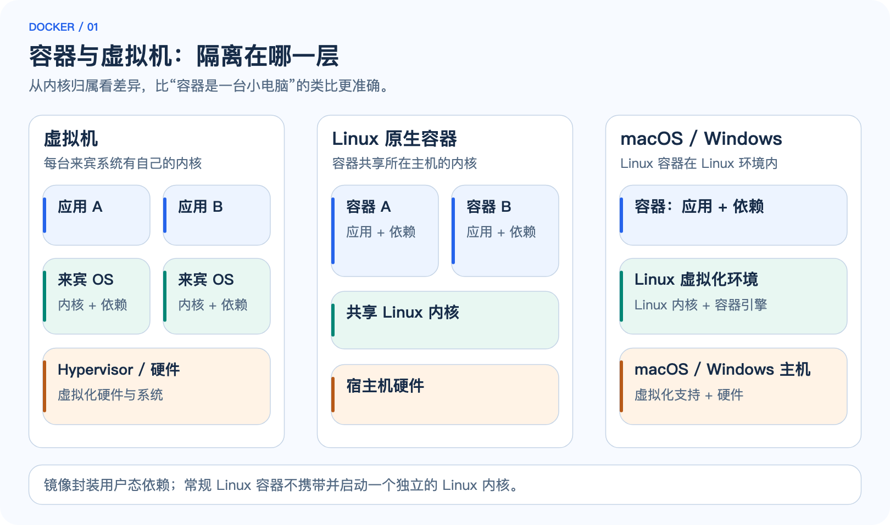
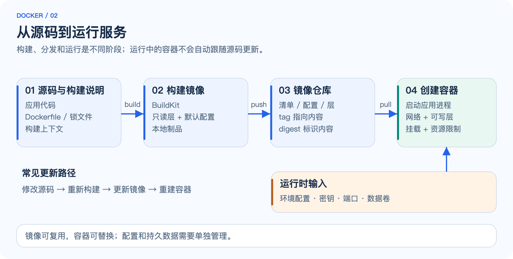
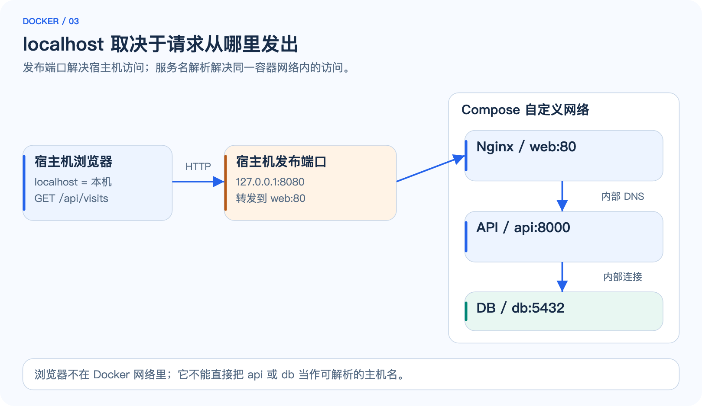
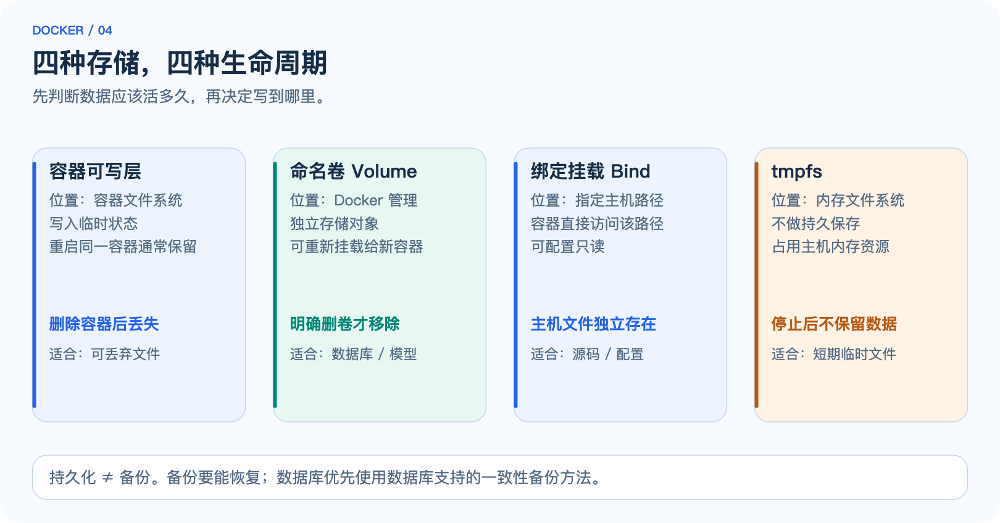
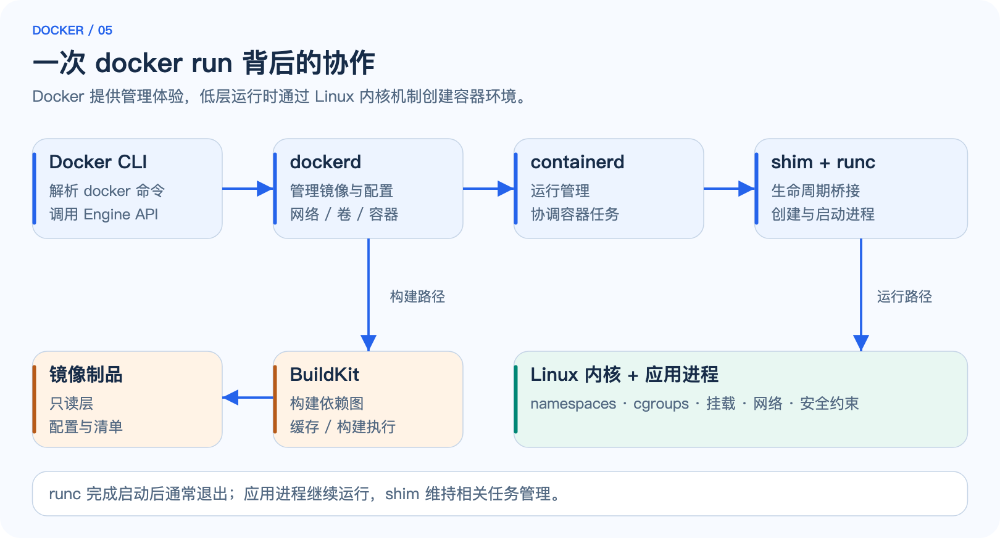
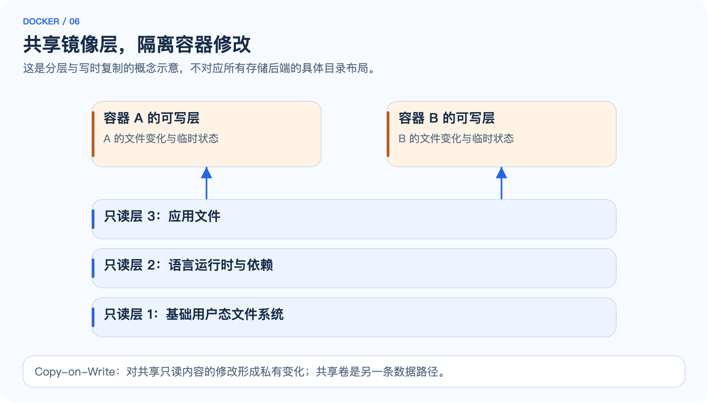
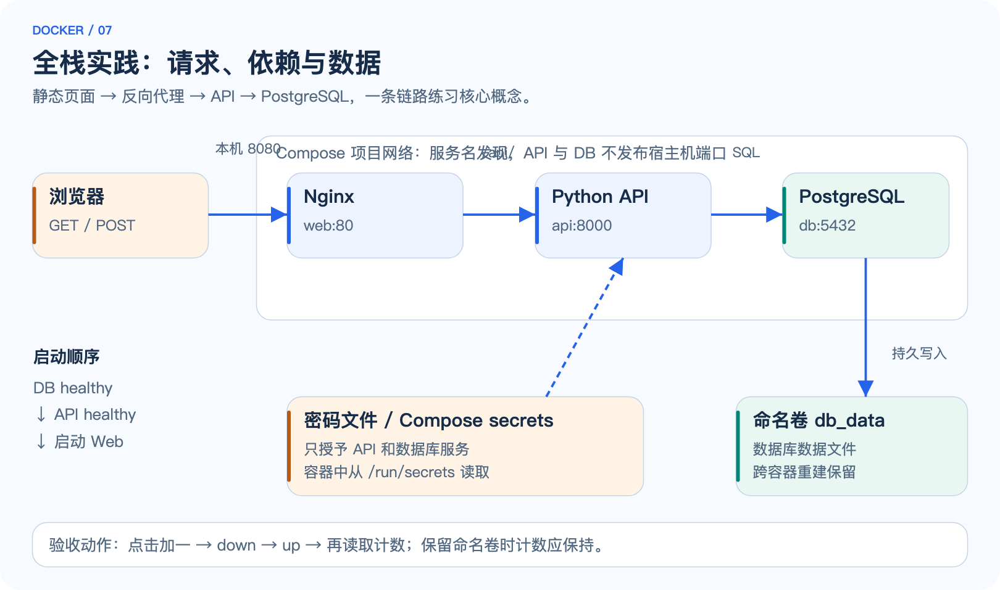
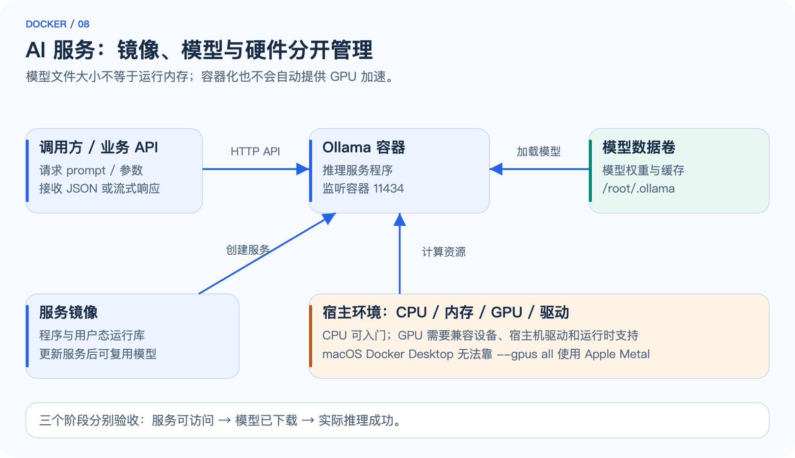

# Docker：从容器入门到全栈与 AI 实践

> **一周一个知识点 · 容器与工程化**  
> 面向有前后端基础的开发者，从“会运行”走向“能解释、能排错、能交付”。  
> 整理与资料核对日期：2026-09-10。本文以 **Linux 容器、Docker CLI、Compose v2** 为主；macOS / Windows 的差异会单独说明。

## 0. 如何使用这份文档

Docker 最值得掌握的能力是：**把应用及其用户态依赖打包成镜像，让应用在受控、可重复的运行环境中启动，并正确处理网络、数据、资源和更新。**

建议分三遍阅读：第一遍读第 1～3 章并运行一个容器；第二遍读第 4～8 章，完成全栈实验；第三遍读第 9～13 章，把 AI 场景、排错和工程实践连起来。每天投入约 60～90 分钟，完整实验可另外安排 2～3 小时。

| 你要学会什么 | 对应内容 | 学完后的检验方式 |
| --- | --- | --- |
| Docker 是什么、解决什么问题 | 第 1～2 章 | 能区分镜像、容器、虚拟机和仓库 |
| 如何使用 Docker | 第 3～5 章 | 能构建、运行、连接、观察和清理容器 |
| Docker 为什么能工作 | 第 6 章 | 能解释隔离、资源限制、分层和运行时 |
| 如何落到真实项目 | 第 7～9 章 | 能运行静态站点、全栈计数器和模型服务 |
| 如何用得稳 | 第 10～13 章 | 能处理故障、保护数据、解释常见误区 |

**文档与附件：** `docker.md` 是正文；`docker.html` 是同源生成、图像内嵌的离线阅读版；`assets/` 保存示意图；`examples/` 保存完整案例。Markdown 与 `assets/` 放在一起即可显示配图。HTML 可单独复制分享，完整案例源码已在正文展开，运行时也可直接使用附带的 `examples/` 目录。

**命令约定：** 代码块不带 shell 提示符，可以复制；多行命令使用 Bash / Zsh 的反斜杠续行。Windows 建议在 WSL2 的 Linux shell 中执行这些实验。所有案例均以本地学习为目标，不需要购买云服务。基础镜像和模型首次下载需要网络及可用磁盘空间。

## 1. Docker 的介绍：解决什么问题

### 1.1 从“我的电脑能跑”开始

设想一个 Web 项目：前端构建需要 Node，API 需要 Python 和系统库，数据库需要 PostgreSQL。开发者电脑、CI 机器和服务器上的版本、路径、环境变量不同，很容易出现“代码一样、行为不同”。只复制源代码，实际上遗漏了大量运行前提。

Docker 让你把这些前提写进构建文件，再产出镜像。团队用同一份镜像创建容器，减少临时安装和手工配置造成的差异。它也让多套依赖相互隔离：一个项目使用 PostgreSQL 17，另一个项目可以使用其他版本，分别管理端口和数据目录。

但**镜像一致不代表所有外部条件一致**。宿主机内核、CPU 架构、挂载数据、环境配置、外部服务、驱动和硬件仍会影响结果。可重复交付需要同时管理镜像、配置、数据迁移和基础设施。[官方概览](https://docs.docker.com/get-started/docker-overview/)

### 1.2 Docker 是什么

Docker 是围绕容器提供的一组开发、构建、分发和运行工具。几个经常混在一起的名字需要分开：

| 名称 | 角色 | 直观理解 |
| --- | --- | --- |
| Docker Engine | 提供容器管理 API 的客户端／服务端系统，包含 `dockerd` 等组件 | 负责管理容器的引擎 |
| Docker CLI | 终端里的 `docker` 命令 | 向引擎发送指令的遥控器 |
| Docker Desktop | 在桌面系统上集成引擎、CLI、Compose 等能力的产品 | 本地开发环境的集成包 |
| Dockerfile | 描述如何构建镜像的文本文件 | 制作说明书 |
| Image，镜像 | 只读的文件系统层与运行配置等内容 | 应用交付模板 |
| Container，容器 | 从镜像创建的运行实例，带独立配置和可写状态 | 正在执行的受隔离进程环境 |
| Registry，镜像仓库服务 | 保存、分发镜像，例如 Docker Hub 或企业仓库 | 镜像的存储与分发站 |
| Compose | 用 YAML 声明并管理一组服务、网络和卷 | 一个项目的启动清单 |

**镜像不是正在运行的程序，容器也不是镜像的另一个名字。** 一份镜像可创建多个容器；它们共享只读镜像内容，但通常拥有各自的可写层、进程和网络环境。

### 1.3 容器与虚拟机有什么区别



*图 1：常规 Linux 容器共享其所在 Linux 主机的内核。macOS / Windows 上的 Linux 容器通常运行在 Linux 虚拟化环境内；容器并没有因此变成 macOS 或 Windows 进程。*

| 维度 | 常规 Linux 容器 | 虚拟机 |
| --- | --- | --- |
| 隔离的主要对象 | 进程视图、文件系统、网络、资源使用等 | 完整机器及来宾操作系统 |
| 内核 | 共享运行它的 Linux 内核 | 通常有自己的来宾内核 |
| 启动 | 主要启动应用进程；一般较快 | 需要启动来宾系统；一般较重 |
| 打包内容 | 应用和所需用户态依赖 | 来宾系统及应用 |
| 资源开销 | 通常更低，但取决于工作负载及桌面虚拟化层 | 通常更高，隔离边界也不同 |
| 适合的边界 | 标准应用交付、依赖隔离 | 不同操作系统、强隔离需求或完整系统实验 |

不要把“容器轻量”理解为“没有成本”或“与虚拟机一样的安全边界”。数据库 I/O、跨架构模拟、桌面文件共享和网络转发都可能带来明显开销。[容器基础](https://docs.docker.com/get-started/docker-concepts/the-basics/what-is-a-container/)

### 1.4 使用场景与不适用场景

| 场景 | Docker 带来的具体收益 | 仍需处理的问题 |
| --- | --- | --- |
| 前端开发 | 用容器统一 Node 版本，构建后用 Nginx 提供静态文件 | 热更新、文件共享性能、浏览器实际访问地址 |
| 后端开发 | 快速获得数据库、缓存和消息队列，减少本机安装污染 | 初始化、就绪检测、连接重试和迁移 |
| CI/CD | 构建测试环境可脚本化，将同一镜像推广到不同环境 | 凭据、制品签名、发布审批与回滚 |
| 单机部署 | 用 Compose 管理多个相互依赖的服务 | 主机故障、备份、监控与容量 |
| AI 推理 | 封装推理服务依赖，复用 API 与部署方式 | 模型文件、许可证、内存／显存、驱动 |
| 短期实验 | 用完移除容器，便于尝试工具和不同版本 | 卷、镜像和缓存可能仍占用空间 |

如果只是执行一个简单脚本，不一定值得引入容器。如果需要完整操作系统行为、内核模块实验，虚拟机往往更合适。如果要跨主机调度、自动扩容和高可用，Docker / Compose 本身不会自动补齐这些能力。

## 2. 安装、环境与核心心智模型

### 2.1 选择运行环境

- **Linux：** 可按发行版安装 Docker Engine 与 Compose 插件。生产主机通常直接运行 Linux 容器。
- **macOS：** Docker Desktop 等容器环境会提供 Linux 虚拟化环境。Apple Silicon 机器优先选择支持 `linux/arm64` 的镜像。
- **Windows：** 本文实验建议使用 Docker Desktop 的 Linux 容器模式与 WSL2。Windows 容器是另一条技术路径，不能简单混用。

安装步骤会随系统和产品版本变化，按官方平台说明操作；涉及公司使用时同时确认产品许可条件。**不需要为了完成本文再安装第二套 Docker 环境。** 已安装其他兼容环境时，先确认当前 CLI 连接的引擎。[Engine 安装](https://docs.docker.com/engine/install/) · [Desktop 安装](https://docs.docker.com/desktop/)

```bash
docker version
docker info
docker compose version
docker context ls
docker context show
```

`docker version` 应同时出现 Client 和 Server 信息；只看到 Client、随后提示无法连接 daemon，说明命令行存在，但目标引擎没有正常连接。`docker context` 决定当前连接哪一个引擎，可能是本机，也可能是远程主机；执行删除命令之前尤其要确认。

### 2.2 从源码到服务的完整路径



*图 2：build 产生镜像，push / pull 分发镜像，run 创建并启动容器。修改源代码不会自动修改已经构建好的镜像。*

```text
源代码 + Dockerfile + 构建上下文
             │ docker build
             ▼
         本地镜像
             │ docker push / pull
             ▼
         镜像仓库
             │ docker run + 配置 + 网络 + 卷
             ▼
         应用容器
```

关键关系：

1. **构建时**决定应用文件、依赖和默认配置。
2. **运行时**决定端口映射、环境变量、挂载、资源限制等。
3. 修改 Dockerfile 或打包进去的代码后，要重新构建并重新创建容器。
4. 容器中的临时修改不会自动回写镜像；应把正式修改写回源代码和 Dockerfile。

### 2.3 Tag、Digest 与平台

`postgres:17-alpine` 中，`postgres` 是镜像名称，`17-alpine` 是标签。标签是可移动的引用；发布者可以把同一标签指向新的内容。`latest` 只是一个普通标签，不保证“最新稳定”或“与你之前运行的完全相同”。

Digest 是内容摘要，形如 `sha256:…`。需要严格复现时，记录完整 digest，并管理依赖锁文件与构建环境。固定 digest 也意味着要有计划地更新安全补丁，不能永远不升级。

```bash
docker pull nginx:stable-alpine
docker image inspect nginx:stable-alpine --format '{{json .RepoDigests}}'
docker buildx imagetools inspect nginx:stable-alpine
```

一个多平台镜像引用可以指向多个平台的清单。Docker 会按目标平台选择相应内容；它不会把任意架构的机器码自动变成原生代码。`--platform linux/amd64` 在 ARM 上可能触发模拟，速度更慢，且不是所有场景都能顺利运行。[多平台构建](https://docs.docker.com/build/building/multi-platform/)

## 3. Docker 的使用：先跑起来，再学会观察

### 3.1 第一个容器

```bash
docker run --rm hello-world
```

如果本地没有镜像，Docker 会尝试从仓库拉取，再创建容器并执行默认程序。程序打印说明后退出。`--rm` 表示退出后自动删除该容器，**并不表示删除镜像**。

接着启动一个本地 Web 服务：

```bash
docker run -d --name docker-week-web \
  -p 127.0.0.1:8081:80 \
  nginx:stable-alpine

curl -I http://127.0.0.1:8081
```

浏览器打开 `http://127.0.0.1:8081`，应看到 Nginx 默认页面。

| 参数 | 意义 | 容易误解的地方 |
| --- | --- | --- |
| `-d` | 后台运行 | 不是让本来已退出的程序保持运行 |
| `--name` | 指定容器名 | 同一引擎中已有同名容器时会冲突 |
| `-p 127.0.0.1:8081:80` | 将本机回环地址的 8081 转发到容器 80 | 左边是宿主机，右边是容器 |
| `nginx:stable-alpine` | 使用指定镜像标签 | 是教学用移动标签，正式交付需记录版本或 digest |

不写绑定地址的 `-p 8081:80` 默认可能向所有主机接口发布端口。本地实验使用 `127.0.0.1`，减少意外暴露；具体网络可达性还受引擎版本、路由和防火墙影响。[端口发布](https://docs.docker.com/engine/network/port-publishing/)

### 3.2 日常命令按任务记

```bash
# 看正在运行的容器；-a 包括已停止的容器
docker ps
docker ps -a

# 查看容器输出；跟随日志时按 Ctrl+C 只结束跟随
docker logs --tail 50 docker-week-web
docker logs -f docker-week-web

# 查看配置、映射和资源消耗
docker inspect docker-week-web
docker port docker-week-web
docker stats --no-stream docker-week-web

# 在运行中的容器内额外执行命令；精简镜像可能没有 bash
docker exec -it docker-week-web sh
# 在打开的容器 shell 中运行 exit，回到宿主机

# 生命周期
docker stop docker-week-web
docker start docker-week-web
docker restart docker-week-web

# 删除前先停止，方便观察生命周期
docker stop docker-week-web
docker rm docker-week-web
```

`docker run` 相当于“创建新容器并启动”；`docker start` 启动已经存在的容器。`docker exec` 运行附加进程，不会改变原始启动命令。容器停止后无法再用 `exec` 进入；先查退出状态和日志。

### 3.3 为什么容器会立刻退出

容器的主要进程结束，容器就会停止。例如 `docker run ubuntu echo hello` 打印完就退出，这是正常行为。不要用 `tail -f /dev/null` 去掩盖应用启动失败。

```bash
docker ps -a
docker inspect docker-week-web --format '{{json .State}}'
docker logs --tail 100 docker-week-web
```

`.State` 中可关注 `Status`、`ExitCode`、`Error`、`OOMKilled` 和健康状态。退出码 137 表示进程收到 SIGKILL 的常见表现，**不能仅凭它断定内存不足**；同时查看 `OOMKilled` 和主机记录。

### 3.4 镜像和容器清理

```bash
docker image ls
docker system df
docker volume ls
docker network ls
```

删除指定容器与删除指定镜像是不同操作。先辨认哪些资源属于本次实验，再执行清理。不要把 `docker system prune -a --volumes` 当成通用“修复命令”。`prune` 各子命令的删除范围不同，使用前阅读提示与帮助；数据卷尤其需要先确认归属和备份。[清理规则](https://docs.docker.com/engine/manage-resources/pruning/)

## 4. 构建自己的镜像：Dockerfile 与 BuildKit

### 4.1 看懂一个真实 Dockerfile

全栈案例 API 的实际 Dockerfile 如下，完整目录在 `examples/fullstack/api/`：

```dockerfile
# syntax=docker/dockerfile:1
FROM python:3.12-slim
ENV PYTHONDONTWRITEBYTECODE=1 PYTHONUNBUFFERED=1
WORKDIR /app
COPY requirements.txt .
RUN pip install --no-cache-dir -r requirements.txt \
    && useradd --uid 10001 --create-home appuser
COPY --chown=appuser:appuser app.py .
USER 10001:10001
EXPOSE 8000
CMD ["python", "app.py"]
```

| 指令 | 作用 | 本例为什么这样写 |
| --- | --- | --- |
| `FROM` | 选择基础镜像或创建构建阶段 | 复用 Python 运行环境 |
| `WORKDIR` | 设置后续工作目录 | 避免依赖隐含路径 |
| `COPY` | 从构建上下文复制文件 | 先依赖、后源码，有利于缓存 |
| `RUN` | 构建阶段执行命令 | 安装包、创建非 root 用户 |
| `ENV` | 设置后续构建及容器默认环境变量 | 避免写 `.pyc`，日志及时输出 |
| `USER` | 指定后续指令及运行时用户 | 降低应用进程权限 |
| `EXPOSE` | 声明应用约定使用的端口 | 文档信息；**不会自动向宿主机发布端口** |
| `CMD` | 指定默认启动命令或参数 | 容器运行时才执行 |

`RUN` 是构建时执行；`CMD` 是启动容器时的默认命令。二者混淆会导致“构建时启动服务器然后卡住”等问题。Dockerfile 中并不是每一条指令都会新增文件系统层，一些指令主要修改镜像配置。[Dockerfile 参考](https://docs.docker.com/reference/dockerfile/)

### 4.2 ENTRYPOINT 与 CMD

```dockerfile
ENTRYPOINT ["python", "app.py"]
CMD ["--port", "8000"]
```

上例默认运行 `python app.py --port 8000`；如果执行 `docker run my-api --port 9000`，追加参数会覆盖 `CMD` 的默认参数，组合为 `python app.py --port 9000`。这里假定应用本身支持这些参数，是语义演示，并非本教程计数器 API 的启动配置。

通常优先使用 JSON 数组形式，也叫 exec form，减少 shell 插入带来的信号和参数问题。`["echo", "$PORT"]` 不会自动展开环境变量，因为没有 shell 参与。必须使用 shell 脚本包装时，最后用 `exec` 交给真实服务进程。

### 4.3 构建上下文与 .dockerignore

```bash
# 在 examples/fullstack/api 目录中执行；末尾的点是构建上下文
docker build -t docker-week-api:1.0 .
```

末尾的 `.` 不是装饰：构建器从这个上下文获取 `COPY` 所需文件。指定 `-f` 只改变 Dockerfile 的位置，不会自动改变上下文。通常不能随意 `COPY` 上下文外的父目录文件。

本例 `.dockerignore`：

```text
__pycache__/
*.pyc
.venv/
.env
.git/
secrets/
```

应额外按项目排除 `node_modules`、`dist`、大数据集、模型缓存和私密文件。排除规则依项目而定：如果构建恰好要复制本地 `dist`，就不能同时忽略它。

### 4.4 分层缓存：把不常变化的东西放前面

对于 Node 项目，通常先复制 `package.json` 和锁文件，执行 `npm ci`，再复制业务源码。这样仅修改源码时，依赖安装步骤更容易命中缓存。任一阶段输入或指令变化，都可能使其依赖的后续步骤重新执行。

缓存不是“永远使用最新依赖”的保证。构建器不会因为远程软件源有新内容，就必然重新执行完全相同的 `RUN` 指令。需要更新基础镜像时使用 `--pull`；需要有意排除缓存影响时使用 `--no-cache`，但不要把它当成日常默认选项。

**BuildKit** 是现代 Docker 构建系统的重要组成部分，支持基于依赖图的构建、缓存、并行执行独立步骤、多阶段构建及 secret mount。`docker buildx` 提供管理和使用构建器的 CLI 能力。[BuildKit](https://docs.docker.com/build/buildkit/) · [构建最佳实践](https://docs.docker.com/build/building/best-practices/)

### 4.5 前端多阶段构建

下面是适合 Vite 等“构建输出为 `dist/`”项目的模式。**前提是目录中已有真实前端源码、`package-lock.json`，并且 `npm run build` 会生成 `dist/`。** 它是迁移到你自己前端项目的模板，不是附件中的静态页面案例。

```dockerfile
# syntax=docker/dockerfile:1
FROM node:22-alpine AS build
WORKDIR /app
COPY package.json package-lock.json ./
RUN npm ci
COPY . .
RUN npm run build

FROM nginx:stable-alpine AS runtime
COPY --from=build /app/dist /usr/share/nginx/html
EXPOSE 80
```

最终镜像只包含 Nginx 与构建结果，不需要携带 Node、源码及完整构建依赖。对于前端路由，还需要配置 Nginx 的 `try_files` 回退。对于原生依赖，Alpine 的 musl 与常见 Debian 镜像的 glibc 存在差异，不能只追求体积最小。[多阶段构建](https://docs.docker.com/build/building/multi-stage/)

另一个常见坑：静态前端的构建变量常常在打包时就写进 JavaScript。运行 Nginx 容器时再加 `-e API_URL=...`，不会自动改写已生成的页面。可以采用同源 `/api` 反向代理、启动时生成公开配置文件，或为不同环境重新构建。浏览器可见配置里不能放服务端密钥。

### 4.6 构建密钥与运行时密钥分开

不要用 `COPY`、`ARG` 或 `ENV` 把仓库令牌写进镜像，也不要假设“下一层删除文件”就能抹掉前层的秘密。构建时访问私有依赖，可使用 BuildKit secret mount：

```dockerfile
# Node 项目的片段；需先 COPY package.json 与 package-lock.json
RUN --mount=type=secret,id=npmrc,target=/root/.npmrc npm ci
```

```bash
# npmrc.private 是你自己准备的私有 npm 配置，不应提交到仓库
docker build --secret id=npmrc,src=./npmrc.private -t my-web:1.0 .
```

secret mount 只在对应构建步骤临时提供文件；如果构建命令主动把它复制到产物或打印到日志，仍会泄漏。运行时密钥则由部署环境注入，Compose 的文件型 secrets 会在第 8 章使用。[构建 secrets](https://docs.docker.com/build/building/secrets/)

## 5. 三个必须掌握的使用专题

### 5.1 网络：搞清楚是谁在访问谁



*图 3：浏览器访问本机发布端口；容器之间通过同一自定义网络上的服务名和容器端口访问。每个环境中的 localhost 指向它自己。*

假设 Compose 中有 `web`、`api`、`db` 三个服务：

| 请求发起者 | 目标 | 应使用的地址示例 |
| --- | --- | --- |
| 本机浏览器 | Nginx | `http://127.0.0.1:8080` |
| Nginx 容器 | API 容器 | `http://api:8000` |
| API 容器 | PostgreSQL | `db:5432` |
| API 容器 | 它自己的健康接口 | `http://127.0.0.1:8000/api/health` |

浏览器运行在宿主机上，即使 JavaScript 是 Nginx 容器提供的，`fetch('http://api:8000')` 也不会凭空获得 Docker 内部 DNS。采用 `fetch('/api/visits')`，让浏览器请求同源 Nginx，再由 Nginx 访问 API，更容易理解和部署。

还要区分：

- `EXPOSE` 是声明；Compose `expose` 也不是宿主机端口发布，更不是可靠的访问控制边界。
- `ports` / `-p` 用于发布端口。容器之间在同一网络通信，通常无需发布数据库端口。
- 应用在容器内监听 `0.0.0.0` 才能接受发往容器网络接口的请求；只监听容器内的 `127.0.0.1` 通常无法被其他容器访问。
- Compose 默认创建项目网络，并提供服务名解析；不要把容器 IP 写死，重建后 IP 可能改变。
- Docker Desktop 通常可用 `host.docker.internal` 访问宿主机。Linux Engine 不应假定自动提供该名称，可按环境显式配置 `host-gateway` 映射。

网络驱动中，`bridge` 适合常见单机容器通信；`host` 共享主机网络命名空间，隔离方式和端口规则不同，且桌面支持受平台配置影响；`none` 不配置常规外部网络。跨主机 overlay 是进一步学习的内容。[网络概览](https://docs.docker.com/engine/network/) · [Compose 网络](https://docs.docker.com/compose/how-tos/networking/)

### 5.2 数据：容器可替换，业务数据要独立



*图 4：数据所在的位置决定了它与容器生命周期的关系。Volume 不自动提供备份；bind mount 也不会把文件复制进镜像。*

| 方式 | 数据在哪里 | 容器删除后的情况 | 典型用途 |
| --- | --- | --- | --- |
| 容器可写层 | 引擎管理的容器文件系统 | 随容器移除而丢失 | 临时文件、可丢弃状态 |
| Named volume，命名卷 | 由 Docker 管理的独立存储对象 | 通常保留，直到明确删除卷 | 数据库、模型缓存 |
| Bind mount，绑定挂载 | 指定宿主机文件或目录 | 宿主机文件仍在 | 开发源码、只读配置 |
| tmpfs | 内存文件系统，受主机内存／交换配置影响 | 停止后不作为持久数据保留 | 短期临时文件 |

**停止或重启同一个容器，不会自动清空它的可写层。** 危险常发生在“删除并重建”之后，因此不能靠“重启后还在”证明持久化方案正确。

```bash
# 只读绑定挂载；运行前确认当前目录确实有 index.html
docker run -d --name docker-week-static \
  -p 127.0.0.1:8081:80 \
  --mount "type=bind,src=$PWD/index.html,dst=/usr/share/nginx/html/index.html,readonly" \
  nginx:stable-alpine
```

挂载会遮住目标路径原有内容，不是与原目录自动合并。`--mount type=bind` 的源路径不存在时通常会报错，这有利于尽早发现拼写错误。远程 Docker 场景下，bind source 是**引擎所在主机的路径**，不是 CLI 客户端电脑上的任意路径。

Linux 上还要留意 UID / GID、文件权限与 SELinux；Docker Desktop 的卷与容器文件系统通常位于其 Linux 环境中，不能直接照搬 Linux 主机的 `/var/lib/docker` 路径。[Volumes](https://docs.docker.com/engine/storage/volumes/) · [Bind mounts](https://docs.docker.com/engine/storage/bind-mounts/)

### 5.3 Compose：把命令变成可维护的项目描述

Compose 用 `compose.yaml` 描述服务，而不是要求你保存十几条长 `docker run` 命令。本文使用 `docker compose`，不依赖旧的独立命令 `docker-compose`。新文件无需为了示例格式添加已过时的顶层 `version:` 字段。

```bash
# 在包含 compose.yaml 的项目目录运行
docker compose config --quiet
docker compose up -d --build --wait
docker compose ps
docker compose logs --tail 100 api
docker compose exec api python --version
docker compose down
```

`config --quiet` 验证 Compose 配置能否解析；`up --build` 根据需要构建并创建／更新服务；`--wait` 等待服务达到运行或健康状态，具体取决于有没有 healthcheck；`down` 移除该项目的容器与项目网络，默认不删除命名卷。

三种状态不要混为一谈：

1. **Running：** 主要进程还活着。
2. **Healthy：** 配置的健康检查成功。
3. **业务可用：** 真实用户路径成功，可能还依赖数据库、权限、外部服务等。

短形式 `depends_on` 主要管理启动顺序。需要等待数据库就绪，应结合 healthcheck 和 `condition: service_healthy`。这不替代应用的重连能力，也不会在数据库之后变成 unhealthy 时自动停止所有依赖服务。

普通 Docker 的 restart policy 根据**进程退出等生命周期条件**工作；健康状态变成 unhealthy 本身不会自动触发重启。Compose 的依赖项内 `restart: true` 与服务级 `restart: unless-stopped` 也不是同一语义。[启动顺序与就绪](https://docs.docker.com/compose/how-tos/startup-order/) · [自动重启](https://docs.docker.com/engine/containers/start-containers-automatically/)

`.env` 常用于 Compose 文件中的变量替换；它不等于自动把全部变量传给所有容器。容器变量需要通过 `environment` 或 `env_file` 等方式声明。使用 `$${VAR}` 可避免被 Compose 提前插值，让变量留给容器内的 shell 处理，本例数据库健康检查会用到。

## 6. Docker 的实现原理：沿着一次启动看进去

### 6.1 CLI、daemon、containerd、runc 分别做什么



*图 5：这是常见 Linux 实现路径的简化图。BuildKit 负责构建；运行路径由引擎、containerd、shim 和低层运行时配合完成，具体进程树和配置会随环境变化。*

当你执行 `docker run nginx:stable-alpine` 时，大体发生以下步骤：

1. **CLI 解析参数并调用 Docker Engine API。** 本机常通过 Unix socket 连接 daemon，远程也可以使用受保护的连接。
2. **引擎检查镜像。** 缺少时，按引用从仓库取得清单、配置和所需层，校验内容并准备本地存储。
3. **引擎准备容器配置。** 包括根文件系统、挂载、网络、环境变量、用户、资源限制和启动命令。
4. **containerd 协调运行时任务。** 常见 Linux 组合通过 shim 与 OCI 运行时管理容器进程。
5. **runc 等 OCI 运行时调用内核能力。** 设置 namespaces、cgroups、挂载、权限限制，创建并启动应用进程。
6. **应用持续运行。** 低层运行时完成创建／启动后通常退出；shim 负责维持与任务相关的生命周期及 I/O 等管理，不能理解成“runc 一直作为应用服务器运行”。

Docker 是上层体验与管理系统；containerd 是容器运行管理组件；runc 是常见的低层 OCI 运行时。它们不是同义词，也不是 Docker 独创的全部能力。OCI 定义了镜像和运行时等规范，帮助不同工具之间互操作。[Docker 架构](https://docs.docker.com/get-started/docker-overview/) · [containerd 文档](https://github.com/containerd/containerd/blob/main/docs/getting-started.md) · [OCI Linux 配置](https://github.com/opencontainers/runtime-spec/blob/main/config-linux.md)

### 6.2 Namespaces：让进程看到不同的世界

Linux 内核的 namespaces 改变进程能够看到或使用的一组系统资源。

| Namespace | 隔离的视图 | 对开发者的具体影响 |
| --- | --- | --- |
| PID | 进程编号和进程视图 | 容器中可能只看到很少的进程；内部 PID 与宿主机 PID 不同 |
| Network | 网卡、路由、端口、网络栈等 | 两个容器可各自监听 8000；localhost 分别指向自己 |
| Mount | 挂载点与文件系统视图 | 容器看到自己的根目录和挂载内容 |
| UTS | 主机名、域名等 | 容器可有自己的 hostname |
| IPC | 部分进程间通信资源 | 隔离共享内存、信号量等 IPC 对象 |
| User | 用户／组 ID 映射与相关权限边界 | 可把容器内用户映射到宿主机不同 UID |
| Cgroup | cgroup 层级的可见视图 | 隐藏或重定位进程看到的资源管理层级 |

不是所有 namespace 都一定默认启用或独立。例如 host 网络模式共享网络 namespace；user namespace 的使用取决于 rootless、userns-remap 等配置。**隔离是具体机制和配置的组合，不是“使用 Docker”四个字自动保证的。**

Linux 主机上的观察示例：

```bash
docker inspect <容器名> --format '{{.State.Pid}}'
# 得到的是引擎所在 Linux 主机的进程 PID；<容器名> 需要替换
# 在该 Linux 主机上可查看 /proc/<PID>/ns/ 下的 namespace 引用
```

macOS 上返回的 PID 属于运行引擎的 Linux 虚拟化环境，不要直接拿它对应 macOS 的进程编号。

### 6.3 Cgroups：控制“能用多少”

Namespaces 主要解决视图和隔离；cgroups 主要负责将进程分组并统计、限制资源。两者回答的是不同问题。

```bash
# 以轻量长期运行命令演示参数；执行后可用 docker stats 观察
docker run -d --name docker-week-limits \
  --memory 256m --cpus 0.5 --pids-limit 100 \
  alpine:3.22 sleep 3600

docker stats --no-stream docker-week-limits
docker stop docker-week-limits
docker rm docker-week-limits
```

`--cpus 0.5` 通常表达可获得约半个 CPU 的时间配额，不是固定“绑在某一颗核”。`--memory` 限制内存，但内存与 swap 的配合由其他参数和主机配置决定。资源不够时可能触发 OOM，应用要有与限制匹配的堆、线程和缓存设置。

没有显式限制的容器可能竞争大量主机资源；在 Docker Desktop 中，Linux 虚拟化环境本身还可能有总资源上限。先看应用负载，再设置限额，不能照抄数字就认为容量足够。[资源约束](https://docs.docker.com/engine/containers/resource_constraints/)

### 6.4 镜像分层与 Copy-on-Write



*图 6：两个容器共享不可变的镜像层，各自拥有可写层。修改低层文件时会按存储实现形成私有修改；删除低层文件通常用遮蔽标记表达，并不重写原镜像。*

以常见 OverlayFS 思路理解：多个只读 lower layer 叠加，一个 upper 可写层承接修改，容器看到合并后的视图。首次修改某个低层文件时可能发生 copy-up；删除低层文件会用 whiteout 等机制在合并视图中隐藏它。

这解释了几个现象：

- 同一镜像创建多个容器，不需要各自完整复制一份所有只读内容。
- 在容器 A 中改文件，不会自动修改镜像或容器 B。
- 在后续镜像层删除前层的大文件，不等于回收前层占用，也不等于抹除秘密。
- 数据库的大量写入适合放在专门的数据卷中，避免把容器可写层当数据库存储设计。

**版本差异：** 不应把 Docker 存储永远等同于经典 `overlay2`。官方文档说明，Engine 29.0 起的全新安装默认使用 containerd image store，通常通过 overlayfs snapshotter 管理快照；从旧版本升级的环境可能继续使用经典 graph driver。OverlayFS 的概念有助于理解，但具体磁盘布局、快照后端与占用统计需要查看实际引擎。

```bash
docker info
docker system df
```

不要手工删除 `/var/lib/docker` 内部目录来“修复空间问题”；让引擎管理自己的对象，并先确认数据与备份。[containerd image store](https://docs.docker.com/engine/storage/containerd/) · [经典 OverlayFS 驱动](https://docs.docker.com/engine/storage/drivers/overlayfs-driver/)

### 6.5 网络路径：veth、bridge 与端口转发

在常见 Linux bridge 网络中，容器有独立网络 namespace，通过虚拟网卡对（veth）连接到主机上的 bridge。Docker 设置路由与必要的防火墙／NAT 规则，让容器之间、容器与外部通信。

发布端口后，发往宿主机某个端口的流量被转发到容器地址和端口。其细节会因 iptables / nftables 后端、IPv4 / IPv6、代理、rootless 或桌面环境而变化；不必把某条固定 iptables 规则当成所有环境的真相。

Compose 的服务名解析帮助应用避免依赖动态 IP。**DNS 解析成功只说明拿到了地址**，不保证端口已监听、数据库已初始化或应用有权限执行 SQL。

### 6.6 PID 1、信号与优雅退出

容器内的 PID 1 有特殊的信号处理和子进程回收语义。服务需要正确处理停止信号、回收子进程，并在退出前停止接单、释放连接、完成必要的收尾。

`docker stop` 通常先发送配置的停止信号，默认多为 SIGTERM，等待超时后再发送 SIGKILL。镜像可以通过 `STOPSIGNAL` 改变默认信号。

实用原则：

- 启动命令使用 exec form；shell 包装最后用 `exec`。
- 应用自己实现优雅退出；单纯写成 exec form 不会自动补出退出逻辑。
- 需要轻量 init 回收子进程时，可使用 `--init` 或 Compose `init: true`。
- 将日志写到 stdout / stderr，便于容器日志系统采集。

全栈案例的 API 使用 exec form、`init: true`，并为 SIGTERM 注册停止 HTTP 服务的处理逻辑。它仍然只是教学 HTTP 服务，不承担生产环境完整的连接管理职责。

### 6.7 安全边界：为什么“容器里是 root”需要认真看待

常规容器共享内核。权限过大、宿主机目录挂载、内核漏洞和 Docker API 暴露，都可能扩大影响范围。

`USER 10001` 让应用以非 root 用户运行；**rootless Docker** 则让 daemon 和容器在非 root 模式下工作，两者解决的问题不同。userns-remap 也不是 rootless 的同义词。

Capabilities 把 root 权能拆细；seccomp 限制系统调用；AppArmor / SELinux 提供额外的强制访问控制。这些机制需要和实际配置配合。不要为解决一个权限问题就直接使用 `--privileged`，也不要随手把 `/var/run/docker.sock` 挂载给不可信应用；控制 Docker API 往往相当于获得极高的主机控制能力。[Docker 安全](https://docs.docker.com/engine/security/) · [Rootless 模式](https://docs.docker.com/engine/security/rootless/)

## 7. 实践一：把静态页面交给 Nginx

**目标：** 学会端口发布、只读绑定挂载、日志和容器清理。约 15～20 分钟。

前提：Docker Server 已连接；本机 8081 端口空闲；第 3 章的 `docker-week-web` 已清理。进入附件目录：

```bash
# 从 docker 文档目录开始
cd examples/static-site
```

实际页面源码：

```html
<!doctype html><html lang="zh-CN"><meta charset="utf-8"><title>第一个 Docker 页面</title>
<style>body{font:20px system-ui;margin:10vw;color:#123}h1{color:#1767df}</style>
<h1>Hello Docker 👋</h1><p>这份页面由容器内的 Nginx 提供。</p></html>
```

启动并检查：

```bash
docker run -d --name docker-week-static \
  -p 127.0.0.1:8081:80 \
  --mount "type=bind,src=$PWD/index.html,dst=/usr/share/nginx/html/index.html,readonly" \
  nginx:stable-alpine

curl -fsS http://127.0.0.1:8081
docker logs --tail 20 docker-week-static
```

浏览器打开 `http://127.0.0.1:8081`，应看到 “Hello Docker”。在宿主机编辑 `index.html`，刷新浏览器即可看到变化，因为 Nginx 读取的是挂载文件。如果浏览器缓存了页面，可强制刷新；个别编辑器使用原子替换保存文件时，可重新创建容器，或开发时改为挂载整个站点目录。

**这个实验不是镜像构建。** 页面通过挂载注入；删除挂载或把镜像单独拿给别人，镜像里不会自动出现你的页面。练习题：新建一个 Dockerfile，将页面 `COPY` 到 Nginx 镜像里，构建并在 8082 端口运行，比较“修改源码后”的更新路径。

```bash
# 清理容器；保留你的页面文件
docker stop docker-week-static
docker rm docker-week-static
```

验收：能说清 `8081:80` 两个端口各属于谁；能解释为什么修改挂载文件无需重建镜像；能从日志看到访问记录。

## 8. 实践二：前端＋API＋PostgreSQL 全栈项目

### 8.1 实验目标和拓扑

**目标：** 用一个计数器串起完整请求链路，理解服务发现、反向代理、就绪检测、密码文件和数据卷。约 60～90 分钟。



*图 7：只有 Nginx 向宿主机发布 8080 端口。API 使用 `db:5432`，数据库写入命名卷；浏览器无需知道 API 和数据库的容器地址。*

功能设计：

- Nginx 提供前端页面，并将 `/api/` 请求代理给 Python。
- `GET /api/visits` 读取计数，`POST /api/visits` 加一并返回结果。
- Python 使用 PostgreSQL 的单条原子更新，避免“先读再写”导致并发丢失更新。
- `GET /api/health` 实际访问数据库；有依赖故障时不会仍然报告健康。
- 数据库使用命名卷；重新创建容器后计数应保留。

这个项目刻意采用少量代码解释基础链路：API 使用 Python 标准库 HTTP server，数据库驱动为 psycopg。它没有完整鉴权、限流、连接池或迁移框架，不能直接当公网生产服务。实验里的 `POSTGRES_USER` 会被官方镜像初始化为数据库超级用户；生产环境应另建权限受限的应用账号。

### 8.2 完整文件结构

```text
examples/fullstack/
├── compose.yaml
├── .gitignore
├── api/
│   ├── app.py
│   ├── requirements.txt
│   ├── Dockerfile
│   └── .dockerignore
├── web/
│   ├── index.html
│   └── default.conf
└── secrets/
    └── db_password.txt   ← 按下一节在本机生成，不随附件分发
```

Dockerfile 和 `.dockerignore` 已在第 4 章完整列出。依赖文件 `api/requirements.txt`：

```text
psycopg[binary]==3.2.10
```

这里锁定驱动的直接依赖版本便于教学；完整的软件供应链复现还需锁定传递依赖、校验值和基础镜像 digest。

`api/app.py`：

```python
"""Docker learning lab: deliberately small synchronous HTTP + PostgreSQL API."""
import json
import os
import signal
import threading
import time
from http.server import BaseHTTPRequestHandler, ThreadingHTTPServer
from pathlib import Path

import psycopg


def connect():
    return psycopg.connect(
        host=os.environ.get("DB_HOST", "db"),
        dbname=os.environ.get("DB_NAME", "lab"),
        user=os.environ.get("DB_USER", "lab"),
        password=Path(os.environ["DB_PASSWORD_FILE"]).read_text().strip(),
        connect_timeout=3,
        options="-c statement_timeout=3000",
    )


def initialize():
    for attempt in range(30):
        try:
            with connect() as db:
                db.execute("CREATE TABLE IF NOT EXISTS counter (id integer PRIMARY KEY, value integer NOT NULL)")
                db.execute("INSERT INTO counter VALUES (1, 0) ON CONFLICT (id) DO NOTHING")
            return
        except psycopg.OperationalError:
            if attempt == 29:
                raise
            time.sleep(2)


class Handler(BaseHTTPRequestHandler):
    def respond(self, code, data):
        payload = json.dumps(data, ensure_ascii=False).encode()
        self.send_response(code)
        self.send_header("Content-Type", "application/json; charset=utf-8")
        self.send_header("Content-Length", str(len(payload)))
        self.send_header("Cache-Control", "no-store")
        self.end_headers()
        self.wfile.write(payload)

    def dispatch(self, increment=False):
        path = self.path.split("?", 1)[0]
        if (increment and path != "/api/visits") or path not in ("/api/health", "/api/visits"):
            self.respond(404, {"error": "not found"})
            return
        try:
            with connect() as db:
                if path == "/api/health":
                    db.execute("SELECT 1")
                    result = {"status": "ok"}
                elif increment:
                    value = db.execute("UPDATE counter SET value = value + 1 WHERE id = 1 RETURNING value").fetchone()[0]
                    result = {"visits": value}
                else:
                    value = db.execute("SELECT value FROM counter WHERE id = 1").fetchone()[0]
                    result = {"visits": value}
            self.respond(200, result)
        except psycopg.Error:
            self.log_error("database operation failed")
            self.respond(503, {"error": "database temporarily unavailable"})

    def do_GET(self):
        self.dispatch()

    def do_POST(self):
        self.dispatch(increment=True)


if __name__ == "__main__":
    initialize()
    server = ThreadingHTTPServer(("0.0.0.0", 8000), Handler)
    # shutdown() must run in a different thread from serve_forever().
    signal.signal(signal.SIGTERM, lambda *_: threading.Thread(target=server.shutdown, daemon=True).start())
    print("API listening on 0.0.0.0:8000", flush=True)
    try:
        server.serve_forever()
    finally:
        server.server_close()
```

启动时进行有上限的数据库连接重试；运行中数据库不可用时请求返回 503。连接和 SQL 都有超时。对失败的 `POST` 不能不加区分地自动重放，否则可能产生重复业务操作；正式业务应根据幂等键和事务边界设计重试。

`web/index.html`：

```html
<!doctype html>
<html lang="zh-CN">
<meta charset="utf-8">
<meta name="viewport" content="width=device-width,initial-scale=1">
<title>Docker 全栈实验</title>
<style>
body{font-family:system-ui,sans-serif;max-width:680px;margin:10vh auto;padding:24px;background:#f2f6fc;color:#123}
main{padding:36px;background:white;border-radius:20px;box-shadow:0 14px 60px #173b6414}
button{background:#1767df;color:white;padding:12px 18px;border:0;border-radius:8px;font-size:16px;cursor:pointer}
button:disabled{opacity:.6}output{font-size:48px;display:block;margin:28px 0}small{display:block;margin-top:22px;line-height:1.8;color:#52647a}
</style>
<main><h1>Docker 全栈计数器</h1><p>浏览器 → Nginx → Python API → PostgreSQL</p>
<output id="count" aria-live="polite">加载中</output><button id="add">计数 +1</button>
<small>重新创建容器后，计数应继续保留在 PostgreSQL 的命名卷中。</small></main>
<script>
const count=document.querySelector('#count');
const button=document.querySelector('#add');
async function update(method='GET'){
  button.disabled=true;
  try{
    const response=await fetch('/api/visits',{method});
    if(!response.ok)throw new Error('HTTP '+response.status);
    const data=await response.json();count.textContent=data.visits;
  }catch(error){count.textContent='请求失败：'+error.message;}
  finally{button.disabled=false;}
}
button.addEventListener('click',()=>update('POST'));
update();
</script>
</html>
```

`web/default.conf`：

```nginx
server {
    listen 80;
    server_name _;
    root /usr/share/nginx/html;
    index index.html;

    location /api/ {
        resolver 127.0.0.11 valid=10s ipv6=off;
        set $api_upstream api:8000;
        proxy_pass http://$api_upstream$request_uri;
        proxy_set_header Host $host;
        proxy_set_header X-Real-IP $remote_addr;
        proxy_connect_timeout 3s;
        proxy_read_timeout 10s;
    }

    location / {
        try_files $uri $uri/ /index.html;
    }
}
```

这里使用 Docker 自定义网络中的内置 DNS 地址 `127.0.0.11`，通过变量形式的上游与短 DNS 缓存重新解析 `api`，减少重建 API 后 Nginx 继续使用旧容器 IP 的问题。`$request_uri` 保留 `/api/...` 路径，API 路由也包含 `/api` 前缀；如果随意在 `proxy_pass` 中增加尾部 `/`，可能改变路径转发语义。[Nginx proxy_pass 官方参考](https://nginx.org/en/docs/http/ngx_http_proxy_module.html#proxy_pass)

### 8.3 Compose 的完整配置

`compose.yaml`：

```yaml
name: docker-week-lab
services:
  web:
    image: nginx:stable-alpine
    ports:
      - "127.0.0.1:8080:80"
    volumes:
      - ./web/index.html:/usr/share/nginx/html/index.html:ro
      - ./web/default.conf:/etc/nginx/conf.d/default.conf:ro
    depends_on:
      api:
        condition: service_healthy
    restart: unless-stopped
    logging:
      driver: local
      options:
        max-size: "10m"
        max-file: "3"

  api:
    build: ./api
    environment:
      DB_HOST: db
      DB_NAME: lab
      DB_USER: lab
      DB_PASSWORD_FILE: /run/secrets/db_password
    secrets:
      - db_password
    depends_on:
      db:
        condition: service_healthy
    healthcheck:
      test: ["CMD", "python", "-c", "import urllib.request; urllib.request.urlopen('http://127.0.0.1:8000/api/health', timeout=4)"]
      interval: 10s
      timeout: 5s
      retries: 6
      start_period: 20s
    init: true
    read_only: true
    tmpfs:
      - /tmp
    cap_drop:
      - ALL
    security_opt:
      - no-new-privileges:true
    mem_limit: 256m
    cpus: 0.50
    restart: unless-stopped
    logging:
      driver: local
      options:
        max-size: "10m"
        max-file: "3"

  db:
    image: postgres:17-alpine
    environment:
      POSTGRES_DB: lab
      POSTGRES_USER: lab
      POSTGRES_PASSWORD_FILE: /run/secrets/db_password
    secrets:
      - db_password
    volumes:
      - db_data:/var/lib/postgresql/data
    healthcheck:
      test: ["CMD-SHELL", "pg_isready -U $${POSTGRES_USER} -d $${POSTGRES_DB}"]
      interval: 5s
      timeout: 3s
      retries: 12
      start_period: 10s
    restart: unless-stopped
    logging:
      driver: local
      options:
        max-size: "10m"
        max-file: "3"

volumes:
  db_data:

secrets:
  db_password:
    file: ./secrets/db_password.txt
```

几个设计细节：

1. 不发布 API 与数据库端口，浏览器统一经 Nginx 访问。
2. `api` 等待 `db` 健康，`web` 等待 `api` 健康。
3. API 的根文件系统只读，`/tmp` 使用 tmpfs，去掉 capabilities，并以非 root 用户运行。
4. API 限额为教学示例；要根据真实请求与依赖内存调整。
5. 每个服务显式配置日志轮转，避免长期运行时日志无界增长。
6. PostgreSQL 17 的数据目录挂载到 `/var/lib/postgresql/data`。官方镜像从 PostgreSQL 18 起调整了 `PGDATA` 和建议挂载方式，不能只改标签而忽略迁移和目录差异。
7. 本地 Compose secrets 挂载密码文件，并非自动加密的中央密钥服务；源文件本身仍需妥善保管。[Compose secrets](https://docs.docker.com/compose/how-tos/use-secrets/) · [PostgreSQL 官方镜像说明](https://github.com/docker-library/docs/blob/master/postgres/README.md)

`.gitignore`：

```text
secrets/
backups/
```

### 8.4 生成本地密码并启动

在 `docker/examples/fullstack` 目录执行。以下步骤要求本机有 Python 3；生成的密码是本地实验专用，不需要手工填写到 Compose 文件中。

```bash
mkdir -p secrets
python3 - <<'PY'
from pathlib import Path
import secrets
p = Path('secrets/db_password.txt')
if not p.exists():
    p.write_text(secrets.token_urlsafe(32) + '\n')
# 教学中多个容器 UID 需要读文件：文件可读，父目录只允许宿主机本人遍历。
# 挂载后 Docker daemon / 获授权容器仍可读取，不等于加密存储。
p.chmod(0o444)
p.parent.chmod(0o700)
print('本地密码文件已准备；不会覆盖已有密码。')
PY

docker compose config --quiet
docker compose up -d --build --wait --wait-timeout 180
docker compose ps
```

首次下载和构建可能较久；等待健康检查超时后先查日志，不能据此断定镜像构建失败。若更改 `POSTGRES_PASSWORD_FILE` 对应的文件，已有数据目录不会自动修改数据库里的密码；官方镜像的初始化变量主要作用于空数据目录。正确修改已有账号密码需要数据库操作，并同步更新应用配置。

本例文件型 secrets 的权限按本地 Linux 容器读取设计。在具有额外 ACL、SELinux 或远程引擎的环境中若遇到权限问题，应检查挂载源、标签与实际 UID；不要把整个项目改成全员可写。

### 8.5 验证一条完整请求

```bash
curl -fsS http://127.0.0.1:8080/api/health
curl -fsS http://127.0.0.1:8080/api/visits
curl -fsS -X POST http://127.0.0.1:8080/api/visits
```

**全新数据卷下的预期输出**分别为：

```json
{"status": "ok"}
{"visits": 0}
{"visits": 1}
```

打开 `http://127.0.0.1:8080`，点击“计数 +1”。前端通过相对路径 `/api/visits` 访问同源服务器；Nginx 在内部网络将请求转发给 API；API 更新 PostgreSQL。已有数据卷或重复执行后，计数不会从 0 开始，这是预期行为。

```bash
# 观察容器间域名解析
docker compose exec api python -c "import socket; print(socket.gethostbyname('db'))"

# 查看链路日志
docker compose logs --tail 50 web api db

# 直接验证数据库状态
docker compose exec db psql -U lab -d lab -c 'SELECT * FROM counter;'
```

### 8.6 验证数据持久化

先记下当前计数，再执行：

```bash
docker compose down
docker compose up -d --wait --wait-timeout 180
curl -fsS http://127.0.0.1:8080/api/visits
```

容器被重新创建后，计数应保持。原因是项目名保持为 `docker-week-lab`，新容器重新挂载同一个 `db_data` 命名卷。重命名项目或使用不同的 `-p` 项目名，可能创建另一套卷，表现得像“数据不见了”；先检查卷归属。

在普通情况下，该卷的引擎对象名是 `docker-week-lab_db_data`：

```bash
docker volume inspect docker-week-lab_db_data
```

不要为了继续学习执行 `down -v`。它会删除本 Compose 项目的命名卷，使计数器数据丢失；这是有意重置实验时才使用的破坏性操作。

### 8.7 故障演练：数据库暂时离线

```bash
docker compose stop db
curl -i http://127.0.0.1:8080/api/visits
docker compose ps
```

预期请求返回 503，或在故障边界出现代理／连接错误；API 的健康检查也会在重试阈值后变成 unhealthy。不要期待它因为 unhealthy 而自动重启。

```bash
docker compose start db
# 等待数据库与 API 的健康检查恢复后重试
curl -fsS http://127.0.0.1:8080/api/health
curl -fsS http://127.0.0.1:8080/api/visits
```

应用每次请求建立数据库连接，所以数据库恢复后新的请求可以重新连上。这不是生产连接池的最佳实现，但很适合观察依赖恢复。计数仍应保留。

### 8.8 做一次备份与恢复演练

数据库文件不能简单靠“复制正在写入的卷目录”就保证一致。这里使用 PostgreSQL 的逻辑备份：

```bash
mkdir -p backups
docker compose exec -T db pg_dump -U lab -d lab -Fc > backups/lab.dump
```

恢复到**新的实验数据库**，验证备份可读，不覆盖原库：

```bash
# restored_lab 必须尚不存在；重复演练请使用另一个新名称
docker compose exec -T db createdb -U lab restored_lab
docker compose exec -T db pg_restore -U lab -d restored_lab \
  --no-owner --no-privileges < backups/lab.dump
docker compose exec -T db psql -U lab -d restored_lab -c 'SELECT * FROM counter;'
```

`-T` 关闭伪终端，适合将二进制 dump 导出到宿主机文件。不要只检查文件存在；真正的验收是能够恢复并查询到预期数据。生产备份还需要权限保护、异地保存、恢复时间目标和周期性演练。

完成后在本目录执行 `docker compose down` 停止实验并保留数据。验收：能解释每一跳地址；能证明数据跨容器重建保留；能通过日志定位数据库不可用；能恢复备份。

## 9. 实践三：用 Docker 运行 AI 推理服务

### 9.1 应用镜像和模型权重为什么分开



*图 8：镜像提供推理服务程序，卷保存下载的模型；请求输入和推理结果通过 API 传递。GPU 能力来自宿主机驱动、运行时和设备支持，不来自镜像本身。*

AI 应用常有三类不同生命周期的内容：服务代码与运行库、模型权重及缓存、运行时参数与凭据。把频繁变化的服务代码和较大的模型权重全部塞进同一个镜像，会增加构建、分发和更新成本。

本例使用 Ollama，先跑一个小模型体验容器化的服务接口。选择 `qwen2.5:0.5b` 是为了降低学习门槛，不表示它适合所有任务或能代表更大模型的回答质量。模型下载体积、运行内存、上下文长度和许可证要分别看；**下载文件大小不等于推理所需内存**。[模型页面](https://ollama.com/library/qwen2.5:0.5b)

### 9.2 CPU 版：从服务启动到第一次推理

前提：Docker Server 可用；11434 端口空闲；为引擎预留数 GB 可用内存和磁盘空间，根据实际占用调整；能够访问镜像和模型下载源。首次下载和 CPU 推理时间因网络与机器而异。

进入 `docker/examples/ai`。实际 `compose.yaml`：

```yaml
name: docker-week-ai
services:
  ollama:
    image: ollama/ollama:latest
    ports:
      - "127.0.0.1:11434:11434"
    volumes:
      - model_data:/root/.ollama
    restart: unless-stopped
    logging:
      driver: local
      options:
        max-size: "10m"
        max-file: "3"
volumes:
  model_data:
```

本例使用 `latest` 对齐官方入门方式，属于便于启动的教学标签。需要重复实验或发布时，应先记录实际拉取的 digest、模型标识与参数，避免后台更新改变行为。

```bash
docker compose up -d

# 等待 HTTP 服务可响应；服务启动并不代表已下载任何模型
curl -fsS --retry 20 --retry-connrefused --retry-delay 2 \
  http://127.0.0.1:11434/api/tags

# 在容器内通过 Ollama 下载模型，写入命名卷
docker compose exec ollama ollama pull qwen2.5:0.5b
docker compose exec ollama ollama list

curl -fsS http://127.0.0.1:11434/api/generate \
  -H 'Content-Type: application/json' \
  -d '{"model":"qwen2.5:0.5b","prompt":"用三句话解释 Docker 镜像和容器的区别。","stream":false}'
```

预期得到 JSON，其中含 `response`、`done` 等字段。回答文本不是固定值；验收看 API 成功返回、模型已加载、日志无异常即可，不应把某一句生成文本当成严格测试断言。小模型也可能答错技术问题，学习结论仍以本文机制解释和官方资料为准。[Ollama Docker](https://docs.ollama.com/docker) · [Generate API](https://docs.ollama.com/api/generate)

```bash
docker compose logs --tail 50 ollama
docker compose exec ollama ollama ps
docker stats --no-stream

# 重建服务，但保留模型卷
docker compose down
docker compose up -d
docker compose exec ollama ollama list
```

最后一条若恰逢服务尚未就绪，可先按前面的 `/api/tags` 步骤等待。模型应仍在，因为 `model_data` 独立于容器。学习结束可 `docker compose down`；删除模型卷会导致后续重新下载，先确认再操作。

### 9.3 NVIDIA GPU：多了哪些前提

在受支持的 Linux + NVIDIA 环境中，需要宿主机安装合适驱动、NVIDIA Container Toolkit，并配置 Docker 运行时，再通过 GPU 参数把设备能力提供给容器。

下面是**替代 CPU 服务的启动方式**。先在 AI 案例目录执行 `docker compose down`，避免端口冲突；本例复用该 Compose 已创建的模型卷。

```bash
# 只在已完成驱动与 Toolkit 配置的兼容环境执行
docker run -d --name docker-week-ollama-gpu \
  --gpus all \
  -p 127.0.0.1:11434:11434 \
  -v docker-week-ai_model_data:/root/.ollama \
  ollama/ollama:latest

# 使用前面的推理请求触发模型加载，再检查实际分配
docker exec docker-week-ollama-gpu ollama ps

# 用完停止并删除容器，保留模型卷
docker stop docker-week-ollama-gpu
docker rm docker-week-ollama-gpu
```

加了 `--gpus all` 不等于“已经在 GPU 上推理”；还要检查实际模型加载、显存容量、运行日志与 `ollama ps`。CUDA 用户态库通常在镜像侧，内核驱动在宿主机侧，兼容性需要一起考虑。

macOS 的 Docker Desktop 环境不能靠 `--gpus all` 获得 Apple Metal 加速。若在 Apple Silicon 上优先追求本机推理性能，可以原生运行 Ollama，把 Web / API 层放进容器，并让容器通过受支持的宿主机地址访问原生服务；这时还需配置原生服务的监听与访问边界。[Ollama GPU 与平台说明](https://docs.ollama.com/faq)

### 9.4 接入自己的 AI 应用

如果后端也运行在同一个 Compose 网络里，可请求 `http://ollama:11434`。浏览器直接请求 `http://ollama:11434` 仍然存在第 5 章的 DNS 问题，通常让你的后端代理模型请求更合适。

进一步扩展时关注：模型加载时间和预热、流式响应、长请求超时、最大并发、显存不足、请求取消、提示词与模型版本记录。推理服务的 TCP 端口可连接，不表示某个模型已加载或有足够内存完成请求。Ollama 本地 API 的例子没有配置公网鉴权，不应直接照搬为对外公开服务。

## 10. 补充：从“能运行”到“可交付”的工程习惯

### 10.1 开发环境与部署环境各自优化

开发时可以把源码 bind mount 到容器，开启热更新，快速验证改动；部署时通常使用已经构建好的镜像，让服务运行的代码与制品记录保持一致。不要在服务器上临时进入容器 `pip install` 或手改文件后就当作完成发布。

一种清楚的交付路径：

1. 提交源码与锁文件。
2. CI 执行测试、构建镜像、生成版本标签与 digest 记录。
3. 按需要做漏洞扫描、SBOM（软件物料清单）和签名验证。
4. 将镜像推送到可信仓库，在测试环境验证。
5. 使用同一制品推广到目标环境，注入对应配置和密钥。
6. 观察健康、错误率和延迟；保留可回退的旧制品。

单机 Compose 更新命令通常是 `docker compose pull` 与 `docker compose up -d`，但是否可以不停机取决于架构、服务数量和连接处理方式，不能宣称执行这两个命令就一定零停机。**应用镜像可以回退，已经执行的数据库迁移不一定能直接回退。** 迁移需要兼容策略、备份与恢复方案。

### 10.2 镜像体积和速度优化有优先级

| 优先处理 | 为什么有价值 | 不要误用为 |
| --- | --- | --- |
| 缩小构建上下文 | 减少传输、泄漏和无效缓存失效 | 无差别忽略构建真正需要的文件 |
| 依赖与源码分开复制 | 让高成本安装步骤更易命中缓存 | 永不更新依赖 |
| 多阶段构建 | 让运行镜像只保留实际运行需要的文件 | 为一个简单静态文件制造复杂构建链 |
| 使用合适的基础镜像 | 平衡体积、兼容性和可维护性 | 永远使用最小镜像 |
| 记录版本并更新 | 可以复现，也能修补漏洞 | 固定在旧 digest 后不再维护 |

镜像压缩大小、解包磁盘占用、容器内存和应用启动时间是四个不同指标。一个 100 MB 镜像可能在运行时消耗数 GB 内存；小镜像也不自动带来更快的业务响应。

### 10.3 安全与稳定性的实际落点

- 只发布业务需要的端口，数据库不因调试方便就默认对外开放。
- 以适合应用的非 root 身份运行，尽量收缩文件写权限、capabilities 与宿主机挂载范围。
- 保持基础镜像与依赖更新，镜像来源可信；扫描结果仍需结合实际可利用性处理。
- 密钥通过运行环境提供，不进入源码、镜像层、前端产物或普通日志。
- 对 CPU、内存、进程数和日志增长建立可观察的上限。
- 数据有备份，而且能够恢复；卷留在原机器上不等于抗主机故障。
- 健康检查既不要永远返回 200，也不要把一次短暂依赖抖动设计成不断重启的反馈循环。

这些是工程判断点，不是把每一条配置机械套给所有服务。比如数据库需要可写的数据目录；非 root 化也必须与挂载文件权限匹配。

### 10.4 Docker、Compose、Kubernetes 的边界

Docker 负责镜像与容器工作流；Compose 擅长描述和运行一组服务，尤其适合本地开发与明确管理的单机项目；Kubernetes 增加集群调度、期望状态控制、服务发现和滚动更新等能力。

Kubernetes 可以运行符合标准的容器镜像，并不要求节点必须通过 Docker Engine 启动容器。不要把“会写 Dockerfile”直接等同于“会管理生产集群”。这一周先掌握镜像、网络、数据与运行机制，下一步再学习编排会更扎实。[Kubernetes 容器运行时](https://kubernetes.io/docs/setup/production-environment/container-runtimes/)

## 11. 排错：用证据缩小问题范围

### 11.1 一条排查顺序

先确认引擎和 context，再确认容器是否创建／运行，然后查应用日志与配置，最后沿请求链逐跳验证。不要一上来就重建全部镜像、清空缓存或删除数据卷。

```bash
# 在全栈实验目录执行
docker version
docker context show
docker compose ps -a
docker compose logs --tail 100 api db web
docker compose config --quiet
docker stats --no-stream
```

需要看展开配置时可使用 `docker compose config`，但输出可能包含通过环境变量注入的秘密；分享诊断信息之前去掉敏感值。对单个容器使用 `docker inspect` 时也一样。

### 11.2 症状、原因与验证动作

| 症状 | 常见原因 | 先做什么 |
| --- | --- | --- |
| `Cannot connect to the Docker daemon` | 引擎未启动、context 错误、socket 权限问题 | 看 `docker context ls`、启动状态和 Server 信息 |
| `port is already allocated` | 宿主机端口被别的服务占用 | 看 `docker ps` 的端口映射，换空闲的宿主机端口 |
| `name is already in use` | 同名停止容器仍存在 | `docker ps -a`，确认后删除指定旧容器或换名 |
| 容器立即退出 | 主进程结束、命令错误、配置缺失 | `.State.ExitCode` 与应用日志 |
| 浏览器打不开，容器还在运行 | 端口没发布、监听地址错、代理路由错误 | `docker port`，检查应用监听和逐跳请求 |
| 前端报 `api` 域名解析失败 | 把 Docker 内部地址写给了浏览器 | 改用同源代理或浏览器能访问的实际地址 |
| API 连接数据库被拒绝 | 错用 localhost、数据库没就绪、服务未连同一网络 | 检查 `DB_HOST`、健康状态和服务名解析 |
| 数据库密码突然失效 | 修改 secret 文件却未修改已有数据库账号 | 核对初始化语义，按数据库流程更新密码 |
| 更改源码没有生效 | 代码打包进旧镜像，未重建／重建后未更新容器 | `docker compose up -d --build`，验证实际制品 |
| 文件权限拒绝 | UID / GID、只读挂载、ACL、SELinux 不匹配 | 查容器用户、目标目录和挂载权限 |
| 重建后“数据消失” | 原来写在可写层、项目名变更、挂错路径、卷被删 | 查看 Compose 项目名与 `docker volume inspect` |
| `exec format error` | 镜像／二进制架构不匹配，或脚本格式问题 | 查看平台、shebang 和换行格式 |
| 退出码 137 | SIGKILL，可能 OOM，也可能人为或超时强杀 | 同时检查 `OOMKilled`、主机日志与资源限制 |
| 镜像下载失败 | DNS、代理、证书、仓库权限或限流 | 读具体错误，检查可信代理和登录配置 |
| AI 首次响应很慢 | 模型下载、冷加载、CPU 推理或内存不足 | 分开观察拉取、加载、推理阶段及资源使用 |
| `unhealthy` 但没有重启 | 健康状态与 restart policy 语义不同 | 查 healthcheck 输出与进程状态，不盲目改重启策略 |

遇到镜像下载的 TLS 问题，应修复网络与证书配置，不应通过关闭证书验证或使用来历不明的镜像源作为默认解决办法。

### 11.3 全栈项目的逐跳检查

```bash
# 1. 从浏览器同一侧访问 Nginx
curl -i http://127.0.0.1:8080/api/health

# 2. 从 Nginx 容器访问 API（本例 Alpine 镜像中使用 wget）
docker compose exec web wget -qO- http://api:8000/api/health

# 3. 在 API 容器里解析数据库服务名
docker compose exec api python -c "import socket; print(socket.getaddrinfo('db', 5432))"

# 4. 数据库是否能够执行查询
docker compose exec db psql -U lab -d lab -c 'SELECT 1;'
```

第二跳成功而第一跳失败，更应检查 Nginx 配置与端口；第三跳能解析、连接仍失败，要继续检查数据库监听、凭据与就绪情况。**每一个命令都应回答一个具体问题。**

## 12. 一周学习计划与动手挑战

### 12.1 七天安排

| 日期 | 主题 | 当天动作 | 应产出的证据 |
| --- | --- | --- | --- |
| 第 1 天 | 概念与运行环境 | 阅读第 1～2 章，确认 Client / Server，运行 hello-world | 用自己的话写清镜像、容器、虚拟机的区别 |
| 第 2 天 | 生命周期与观察 | 阅读第 3 章，完成静态站点实验 | 页面可访问，能查日志、停止和删除容器 |
| 第 3 天 | 镜像构建 | 阅读第 4 章，将静态页 COPY 进镜像，再修改重建 | 比较 bind mount 与镜像发布的更新过程 |
| 第 4 天 | 网络、卷与 Compose | 阅读第 5 章，运行全栈计数器 | 画出地址表，证明容器重建后计数保留 |
| 第 5 天 | 实现原理 | 阅读第 6 章，观察 PID、限额、镜像信息 | 能解释隔离与限额、只读层与可写层 |
| 第 6 天 | AI 服务 | 阅读第 9 章，下载小模型并调用 API | 成功返回 JSON，重建后仍可列出模型 |
| 第 7 天 | 故障与工程化 | 做数据库离线、备份恢复实验，回答复盘题 | 留下一份排错记录和改进计划 |

### 12.2 四个进阶挑战

1. **前端方向：** 将你自己的 Vue / React 应用改为多阶段构建，配置刷新子路由不返回 404，解释公开构建变量与服务端密钥的区别。
2. **后端方向：** 将教学 API 换成你熟悉的 Spring Boot、FastAPI 或 Node 框架，加上连接池、业务超时和优雅退出。注意健康检查端点的职责。
3. **工程方向：** 给全栈项目建立自动构建流程，记录镜像 digest，验证测试与部署使用同一制品，并为数据库迁移设计回退策略。
4. **AI 方向：** 在现有 API 中增加 `/api/chat`，从服务端请求 `ollama:11434`，实现流式输出、取消请求和并发上限，记录模型与提示词版本。

建议每个挑战都保留“假设 → 操作 → 输出 → 结论”四项记录，避免只留下能复制的命令。

## 13. 复盘题：能否脱离命令解释 Docker

先自己作答，再看参考要点。

| 问题 | 参考要点 |
| --- | --- |
| 1. 容器是轻量虚拟机吗？ | 可以帮助初步类比，但原理不同；普通 Linux 容器共享内核，依赖内核隔离机制 |
| 2. 一个镜像运行两个容器，A 修改文件会影响 B 吗？ | 各自可写层通常独立；如果共享同一个可写卷或宿主机路径，仍可能相互影响 |
| 3. 为什么写了 EXPOSE 还不能从宿主机访问？ | EXPOSE 不发布端口，还要看 `-p` / `ports`、监听地址、网络和防火墙 |
| 4. 为什么容器内访问 localhost 连不上数据库？ | localhost 指向该容器自己的网络环境，跨服务通常用数据库服务名 |
| 5. 为什么浏览器不能解析 api 这个服务名？ | 浏览器不在 Docker 内部网络，页面来源不改变浏览器的 DNS 环境 |
| 6. Docker stop 会删除文件吗？ | 通常不会清空同一容器可写层；删除容器与删除卷是另外的操作 |
| 7. 使用 volume 就可以不备份了吗？ | 不能；它独立于容器，但仍可能受误删、主机故障和数据损坏影响 |
| 8. depends_on 能保证数据库永远可用吗？ | 不能；需要就绪检测，运行中仍需超时、重连和业务级容错 |
| 9. unhealthy 会自动触发 restart 吗？ | 普通 Docker restart policy 不因 unhealthy 状态本身自动重启 |
| 10. 为什么 COPY 源码放在依赖安装后面？ | 让不涉及依赖变化的源码修改更容易复用依赖缓存 |
| 11. 使用相同 tag 是否意味着内容完全相同？ | 不一定，tag 可移动；严格记录用 digest，并同时管理配置与外部依赖 |
| 12. 为什么删掉 Dockerfile 后一层的秘密仍不安全？ | 早期层或构建记录可能仍保存内容，应该从一开始避免打包秘密 |
| 13. `--cpus 0.5` 是分配半颗物理 CPU 吗？ | 通常是时间配额含义，不等于固定 CPU 亲和性 |
| 14. 构建前端之后再加环境变量一定会改变页面吗？ | 不一定，静态前端配置可能已编译进产物，需运行时配置方案或同源代理 |
| 15. AI 镜像相同，推理结果一定相同吗？ | 不一定，模型版本、采样、硬件、运行库、上下文和并发等都会影响 |

如果你能不看答案解释其中至少 12 个问题，并独立完成全栈项目的重建、排错与恢复实验，就已具备继续学习容器工程化的基础。这个阈值是自学检验建议，不是专业认证标准。

## 14. 官方资料与验证说明

### 14.1 按主题继续阅读

以下均为官方文档、项目规范或官方项目维护的资料。本文结合多个来源进行解释与原创案例设计，不依赖转载教程。

| 主题 | 入口 |
| --- | --- |
| Docker 平台与组件 | [Docker overview](https://docs.docker.com/get-started/docker-overview/) |
| 容器基础 | [What is a container?](https://docs.docker.com/get-started/docker-concepts/the-basics/what-is-a-container/) |
| 安装 | [Docker Engine](https://docs.docker.com/engine/install/) · [Docker Desktop](https://docs.docker.com/desktop/) |
| Dockerfile 指令 | [Dockerfile reference](https://docs.docker.com/reference/dockerfile/) |
| 构建实践 | [Best practices](https://docs.docker.com/build/building/best-practices/) · [Multi-stage](https://docs.docker.com/build/building/multi-stage/) |
| 构建系统与密钥 | [BuildKit](https://docs.docker.com/build/buildkit/) · [Build secrets](https://docs.docker.com/build/building/secrets/) |
| 多平台 | [Multi-platform builds](https://docs.docker.com/build/building/multi-platform/) |
| 网络 | [Engine networking](https://docs.docker.com/engine/network/) · [Port publishing](https://docs.docker.com/engine/network/port-publishing/) |
| Compose | [Networking](https://docs.docker.com/compose/how-tos/networking/) · [Startup order](https://docs.docker.com/compose/how-tos/startup-order/) · [Secrets](https://docs.docker.com/compose/how-tos/use-secrets/) |
| 数据挂载 | [Volumes](https://docs.docker.com/engine/storage/volumes/) · [Bind mounts](https://docs.docker.com/engine/storage/bind-mounts/) |
| 镜像与快照 | [Containerd image store](https://docs.docker.com/engine/storage/containerd/) · [OverlayFS driver](https://docs.docker.com/engine/storage/drivers/overlayfs-driver/) |
| 资源与运行策略 | [Resource constraints](https://docs.docker.com/engine/containers/resource_constraints/) · [Restart policies](https://docs.docker.com/engine/containers/start-containers-automatically/) |
| 安全 | [Security](https://docs.docker.com/engine/security/) · [Rootless](https://docs.docker.com/engine/security/rootless/) |
| 运行时规范 | [OCI runtime spec](https://github.com/opencontainers/runtime-spec/blob/main/config-linux.md) · [containerd](https://github.com/containerd/containerd/blob/main/docs/getting-started.md) |
| Nginx 代理行为 | [proxy_pass](https://nginx.org/en/docs/http/ngx_http_proxy_module.html#proxy_pass) |
| PostgreSQL 镜像 | [官方镜像说明](https://github.com/docker-library/docs/blob/master/postgres/README.md) |
| Ollama | [Docker](https://docs.ollama.com/docker) · [Generate API](https://docs.ollama.com/api/generate) · [FAQ](https://docs.ollama.com/faq) |
| 模型 | [Qwen2.5 0.5B 模型页](https://ollama.com/library/qwen2.5:0.5b) |
| 编排延伸 | [Kubernetes container runtimes](https://kubernetes.io/docs/setup/production-environment/container-runtimes/) |

### 14.2 本文的验证范围

本文的命令、目录和配置按附件保持一致；两种文档由同一 Markdown 正文生成，示意图为本次学习资料原创。以下是本次实际执行的检查范围。

| 检查项 | 本次结果 |
| --- | --- |
| 正文与源码一致性 | 15 章、47 个代码块；HTML 与 Markdown 的代码块逐一一致，案例源码已与正文核对 |
| 配图文件 | 8 张原创 SVG 与同名 PNG 均存在，SVG 可解析，Markdown 本地图片路径有效 |
| Compose 配置 | 全栈与 AI 两份配置通过 `docker compose config --quiet` |
| 代码静态检查 | API Python 语法、前端 JavaScript 语法、正文 31 段 Bash 命令语法通过 |
| HTML 交互 | 15 个章节链接有效；代码复制内容一致；配图放大与关闭正常 |
| 离线与排版 | Chrome 下禁用网络仍可读取正文与全部配图；桌面及 390px 窄屏检查通过，无整页横向溢出 |
| 打印样式 | 保留正文并隐藏目录、复制与导航控件；未将 PDF 作为本次交付物 |
| 浏览器错误 | 检查过程中未出现页面 JavaScript 异常 |

**容器运行限制：** 生成文档时，本机 Docker Client 为 28.5.2、Compose 为 v2.40.3，当前 `orbstack` context 对应的 daemon 未启动／不可连接。因此没有声称执行过镜像构建、容器健康检查、真实 PostgreSQL 读写、备份恢复或模型推理；以上实验输出标为预期结果。启动可用的 Docker Server 后，按各案例的验收步骤进行实际验证。

**版本说明：** 教学镜像标签主要固定大版本或发行系列，部分使用滚动标签。它们用于说明操作路径，不能作为长期完全复现的保证。请记录实际测试时的镜像 digest、Docker / Compose 版本、CPU 架构与模型信息。官方网页会更新，平台限制和具体命令选项应结合你的版本核对。
