# React：从组件思维到工程实践

> **一周一个知识点 · 前端与工程化**  
> 面向有 HTML / CSS / JavaScript 基础的开发者，从“会写组件”走向“能解释、能排错、能交付”。  
> 整理与资料核对日期：2026-09-15。本文以 **React 19、函数组件与 Hooks、Vite 构建** 为主线；不同框架版本之间的差异会单独说明。

## 0. 如何使用这份文档

React 最值得掌握的能力是：**用组件描述界面，把数据的变化自动变成界面的变化，并用声明式的方式组织可复用的 UI 逻辑。**

建议分三遍阅读：第一遍读第 1～4 章并运行一个组件；第二遍读第 5～7 章，理解状态、Hooks 与渲染原理；第三遍读第 8～15 章，完成 Todo、请求、路由与部署实践。每天投入约 60～90 分钟，完整实验可另外安排 2～3 小时。

| 你要学会什么 | 对应内容 | 学完后的检验方式 |
| --- | --- | --- |
| React 是什么、解决什么问题 | 第 1～2 章 | 能区分声明式与命令式，能说清组件、JSX、Props |
| 如何使用 React | 第 3～5 章 | 能编写组件、管理 State、处理事件与列表 |
| React 为什么能工作 | 第 6～7 章 | 能解释虚拟 DOM、协调、Fiber、双缓存与并发渲染 |
| 如何落到真实项目 | 第 8～10 章 | 能完成 Todo、请求后端、配置路由 |
| 如何用得稳 | 第 11～15 章 | 能设计组件、排查故障、解释常见误区 |

**文档与附件：** `react.md` 是正文；`react.html` 是同源生成、图像内嵌的离线阅读版；`assets/` 保存示意图；`tools/` 保存生成脚本。Markdown 与 `assets/` 放在一起即可显示配图。HTML 可单独复制分享，所有示例代码已在正文展开，可复制到本地练习。

**命令约定：** 代码块不带 shell 提示符，可以复制。所有案例均以本地学习为目标，不需要购买云服务。首次创建项目和安装依赖需要网络连接。文中示例尽量保持小而完整：同一段代码同时展示概念，不追求生产级复杂度。

## 1. React 的介绍：解决什么问题

### 1.1 从“页面能显示”开始

设想一个计数器页面：用户点按钮，数字加一。用原生 JavaScript 写，你需要先找到按钮、再找到数字节点，注册事件，然后在回调里读取旧值、计算新值、写回 DOM：

```javascript
let count = 0;
const button = document.querySelector('#add');
const output = document.querySelector('#count');
button.addEventListener('click', () => {
  count += 1;
  output.textContent = String(count);
});
```

代码不长，但问题会随界面复杂迅速放大：页面有几十个互相影响的区域时，“先改哪个节点、再改哪个节点”的命令式逻辑会越来越难维护。你不仅要描述**界面长什么样**，还要手动管理**每一步怎么改**。

React 换了一个角度：你只需要描述 **“数据是什么，界面应该长什么样”**，React 负责把数据变成 DOM。同一个计数器用 React 写，核心只有两件事——保存状态、声明界面：

```jsx
import { useState } from 'react';

export default function Counter() {
  const [count, setCount] = useState(0);
  return (
    <div>
      <output>{count}</output>
      <button onClick={() => setCount(count + 1)}>计数 +1</button>
    </div>
  );
}
```

点击按钮后，React 会重新执行组件函数、得到新的界面描述，然后以最小代价更新真实 DOM。你不需要告诉它“把哪个节点改成什么”，只要告诉它 **“count 变成了几”**。[React 官方教程](https://react.dev/learn)

### 1.2 React 是什么

React 是一个用于构建用户界面的 JavaScript 库，围绕“组件”组织一切。几个经常混在一起的名字需要分开：

| 名称 | 角色 | 直观理解 |
| --- | --- | --- |
| React 库 | 提供组件、JSX、Hooks 等能力 | 描述界面的核心库 |
| react-dom | 把 React 元素渲染到浏览器 DOM 中 | React 与浏览器的桥 |
| 组件（Component） | 返回界面的函数或类 | 界面的一个“积木块” |
| JSX | JavaScript 的语法扩展，写起来像 HTML | 描述界面结构的语法糖 |
| Props | 父组件传给子组件的数据（只读） | 组件的“入参” |
| State | 组件内部的可变数据 | 组件的“记忆” |
| Hooks | 在函数组件中接入状态与副作用的能力 | 函数组件的“工具函数” |
| 虚拟 DOM | 内存中的界面描述树，用于高效更新 | 真实 DOM 的“草稿” |

**组件不是页面，JSX 也不是 HTML。** 组件是返回界面描述的 JavaScript 函数；JSX 最终被编译成普通的 JavaScript 调用，再由 react-dom 渲染成浏览器节点。[React 概念](https://react.dev/learn/thinking-in-react)

### 1.3 与原生 JavaScript 和 Vue 有什么区别

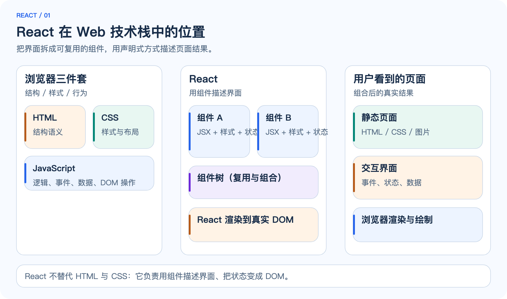

*图 1：React 不替代 HTML 与 CSS。它负责用组件描述界面，把状态变成 DOM；浏览器最终渲染的还是标准 HTML / CSS / JavaScript。*

| 维度 | 原生 JavaScript | React | Vue（同为组件化框架） |
| --- | --- | --- | --- |
| 更新界面的方式 | 手动操作 DOM（命令式） | 声明式：数据变化自动更新 | 声明式：模板 + 响应式数据 |
| 描述界面的语法 | 无统一约定 | JSX（JavaScript 内写结构） | 模板（类 HTML 语法） |
| 组件化 | 需自行设计 | 一等公民 | 一等公民 |
| 学习曲线 | 无框架负担但难规模化 | 需要接受“数据驱动”思维 | 模板友好，上手平缓 |
| 适用场景 | 简单页面、脚本增强 | 中大型交互界面 | 中大型交互界面 |

“用原生 JS 也行”是对的，但它没有回答“如何维护”。当页面有大量状态、多个视图互相联动时，声明式组件模型能显著降低心智负担。这不是说 React 永远更优：一个纯静态页或单次脚本，直接写 HTML / JS 通常更简单，不值得引入框架。

### 1.4 使用场景与不适用场景

| 场景 | React 带来的具体收益 | 仍需处理的问题 |
| --- | --- | --- |
| 交互式单页应用 | 组件复用、状态集中、更新自动 | 路由、状态拆分、性能优化 |
| 后台管理系统 | 表格、表单、弹窗等可组件化 | 权限、接口约定、大数据量渲染 |
| 移动端 / 桌面端 | React Native / Electron 复用组件思维 | 平台差异、原生能力桥接 |
| 服务端渲染（SSR） | Next.js 等框架支持首屏优化与 SEO | 部署复杂度、数据获取时机 |
| 简单静态页面 | 收益有限 | 框架体积、构建链复杂度 |
| 强计算或游戏场景 | 渲染模型不匹配高频逐帧更新 | 需要 Canvas / WebGL 等专门方案 |

如果只是给现有页面加几个交互点，不一定值得引入 React。如果需要完整框架能力（路由、SSR、数据获取约定），通常直接选 Next.js 等框架比手动拼装更合适。[React 生态](https://react.dev/learn/start-a-new-react-project)

## 2. 安装、环境与核心心智模型

### 2.1 选择运行环境

React 本身是纯 JavaScript 库，但现代开发几乎都会用到工具链。本文使用 **Node.js + Vite**：

- **Node.js：** 提供 JavaScript 运行时与包管理。建议安装当前 LTS 版本；`node -v` 与 `npm -v` 确认可用。
- **Vite：** 本地开发服务器与构建工具。启动快、配置少，是 React 官方推荐的起步方式之一。
- **浏览器：** Chrome / Edge / Firefox 任一即可，配合开发者工具观察组件与网络请求。

```bash
node -v
npm -v
```

如果你已有其他构建工具（Webpack、Parcel 等）的项目，本文命令不要求迁移；思路一致，命令有差异。**不需要为了完成本文再安装第二套 Node 环境。** 也可以直接在浏览器里用 CodeSandbox / StackBlitz 体验 React，跳过本地安装。[Vite 官方文档](https://vitejs.dev/) · [React 入门](https://react.dev/learn/installation)

### 2.2 创建第一个 React 项目

Vite 提供脚手架命令，一条命令生成项目骨架：

```bash
npm create vite@latest react-week -- --template react
cd react-week
npm install
npm run dev
```

浏览器打开终端提示的地址（默认 `http://localhost:5173`），应看到 Vite + React 的欢迎页。项目结构大致如下：

```text
react-week/
├── index.html          # 唯一的 HTML 入口
├── package.json        # 依赖与脚本
├── vite.config.js      # Vite 配置（代理、插件等）
└── src/
    ├── main.jsx        # 应用入口：挂载根组件
    ├── App.jsx         # 根组件
    └── index.css       # 全局样式
```

打开 `src/main.jsx` 可以看到入口如何把根组件挂到 HTML 节点上：

```jsx
import { StrictMode } from 'react';
import { createRoot } from 'react-dom/client';
import App from './App.jsx';
import './index.css';

createRoot(document.getElementById('root')).render(<App />);
```

`createRoot(...).render(<App />)` 是 React 19 及 18+ 的标准挂载方式：告诉 react-dom 把 `<App />` 渲染进 `#root` 节点。开发模式下 `StrictMode` 会让组件额外执行一次渲染，帮助你尽早暴露不纯的副作用代码，这是有意设计，不是 bug。

### 2.3 从源码到页面的完整路径

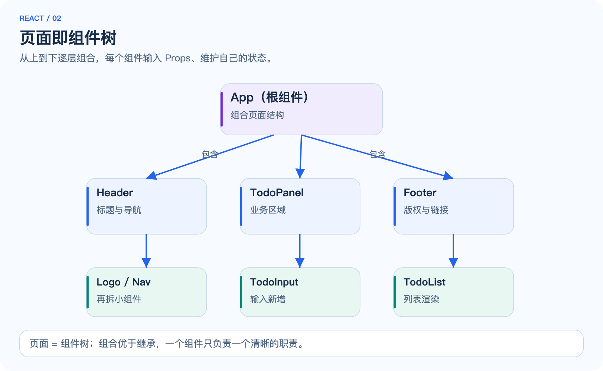

*图 2：组件从上到下组合成树。根组件返回子树，子树再返回更小的组件；浏览器最终看到的页面由整棵组件树渲染而来。*

```text
JSX 源码 + 组件函数 + State/Props
             │ 编译与执行
             ▼
          React 元素（虚拟 DOM 树）
             │ 协调（diff）
             ▼
          差异更新
             │ react-dom 提交
             ▼
          真实 DOM → 浏览器绘制
```

关键关系：

1. **编写时**决定组件结构、Props 与 State 的组织。
2. **运行时**执行组件函数，生成界面描述，React 计算差异并更新 DOM。
3. 修改源码后，开发服务器会热更新；生产环境需要重新构建再部署。
4. 浏览器最终看到的永远是标准 DOM，React 只是更新它的方式。

### 2.4 核心心智模型：声明式

命令式是“告诉我每一步怎么做”；声明式是“告诉我结果是什么，你来想办法”。React 要求你从命令式切换为声明式：

```jsx
// 命令式思维：我要先清空列表，再遍历插入节点……
// 声明式思维：列表数据是什么，界面就渲染成什么
function List({ items }) {
  return (
    <ul>
      {items.map((item) => (
        <li key={item.id}>{item.name}</li>
      ))}
    </ul>
  );
}
```

这个思维转变是 React 学习里最重要的一步：**把“如何更新”交给框架，把“数据是什么”留给自己。**

## 3. 核心概念一：JSX 与组件

### 3.1 JSX 是什么

JSX 是 JavaScript 的语法扩展，写起来像 HTML，但本质是函数调用。同一段结构有两种等价写法：

```jsx
// JSX 写法
const element = <h1 className="title">你好，React</h1>;

// 等价于编译后的调用
const element = React.createElement('h1', { className: 'title' }, '你好，React');
```

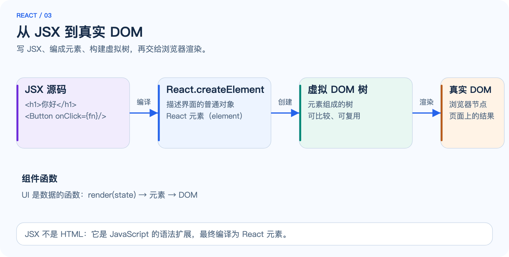

*图 3：JSX 编译为 React.createElement 调用，得到普通对象（React 元素）；元素组成虚拟树，最后由 react-dom 渲染成真实 DOM。*

JSX 的规则要点：

| 规则 | 示例 | 为什么 |
| --- | --- | --- |
| 必须有一个根元素 | `<div>...</div>` 或片段 `<>...</>` | 组件必须返回单一结构 |
| 表达式用花括号 | `{count}`、`{items.length}` | 在 JSX 中嵌入 JavaScript 表达式 |
| `class` 写作 `className` | `<h1 className="title">` | `class` 是 JS 保留字 |
| 属性名用驼峰 | `onClick`、`tabIndex` | 对应 DOM 属性的 JS 命名 |
| 标签可自闭合 | `` | 与 HTML 的宽松写法不同 |

```jsx
function Profile({ user }) {
  return (
    <div className="card">
      
      <h2>{user.name}</h2>
      {user.bio ? <p>{user.bio}</p> : <p>这个人很神秘，没有写简介。</p>}
    </div>
  );
}
```

**JSX 不是 HTML。** 它没有 HTML 的宽松容错；`onclick` 与 `onClick` 是两个东西，`class` 与 `className` 也是两个东西。写 JSX 时按 JavaScript 的规则思考，而不是按 HTML 的规则。[JSX 深入](https://react.dev/learn/writing-markup-with-jsx)

### 3.2 组件：函数的另一种形式

组件是返回 JSX 的 JavaScript 函数。组件名必须以大写字母开头，React 用大小写区分“组件”和“原生标签”：

```jsx
function Greeting() {
  return <p>你好！</p>;
}

// 使用组件：像写 HTML 标签一样写组件名
function App() {
  return (
    <div>
      <Greeting />
      <Greeting />
    </div>
  );
}
```

组件可以像函数一样复用、组合、传参。组件每次渲染，函数体都会重新执行一遍——理解这一点是后面理解渲染性能的基础。

### 3.3 Props：向组件传数据

Props 是组件的入参，由父组件传入、子组件只读使用。**组件不能修改自己的 props**；需要变化的数据应放在 State 里：

```jsx
function Avatar({ name, size = 64 }) {
  return ;
}

function App() {
  return <Avatar name="react" size={96} />;
}
```

Props 是单向的：数据从父组件流向子组件。子组件想把变化告诉父组件时，通过父组件传下来的**回调函数**触发，而不是直接改父组件的数据。这是第 4 章状态提升的基础。

### 3.4 组件树与文件组织

一个页面通常是一棵组件树：根组件组合区域组件，区域组件再拆分小组件。**组合优于继承**：用 Props 传入内容，而不是通过“继承父类”扩展界面。

```jsx
function Layout({ header, children }) {
  return (
    <div>
      <header>{header}</header>
      <main>{children}</main>
    </div>
  );
}

// 使用：把任意内容作为 children 传入
<Layout header={<Nav />}>
  <Article />
</Layout>
```

`children` 是 Props 的一个特殊约定：标签之间的内容会作为 `children` 传入。这是 React 实现“插槽式布局”的核心手法。[组合 vs 继承](https://react.dev/learn/thinking-in-react)

## 4. 核心概念二：State 与事件

### 4.1 useState：组件的记忆

组件需要记忆变化的数据，用 `useState` 声明：

```jsx
import { useState } from 'react';

function Counter() {
  const [count, setCount] = useState(0); // 初始值 0
  return (
    <div>
      <output>{count}</output>
      <button onClick={() => setCount(count + 1)}>+1</button>
    </div>
  );
}
```

要点：

- `useState(0)` 返回一个数组：当前值 `count` 与更新函数 `setCount`。
- 调用 `setCount(newValue)` 会**调度一次重新渲染**：组件函数重新执行，拿到新值。
- 直接修改变量（`count = count + 1`）不会触发渲染；必须通过更新函数。
- State 是组件私有的：同一个组件渲染两次，它们的 State 互不影响。

### 4.2 事件处理与受控组件

React 事件用驼峰属性绑定：`onClick`、`onChange`、`onSubmit` 等。表单元素把“值”与“变化事件”绑定到一起，就成了**受控组件**——输入框的值由 State 决定：

```jsx
function NameForm() {
  const [name, setName] = useState('');
  return (
    <form onSubmit={(e) => { e.preventDefault(); console.log('提交：', name); }}>
      <input
        value={name}
        onChange={(e) => setName(e.target.value)}
        placeholder="输入你的名字"
      />
      <button type="submit">提交</button>
    </form>
  );
}
```

`onChange` 里 `setName(e.target.value)` 让输入框的每一次敲击都写进 State，State 再回流到 `value`，形成单向闭环。**受控组件让“表单当前值”永远与 State 一致**，方便校验、清空、回显。

### 4.3 单向数据流与状态提升

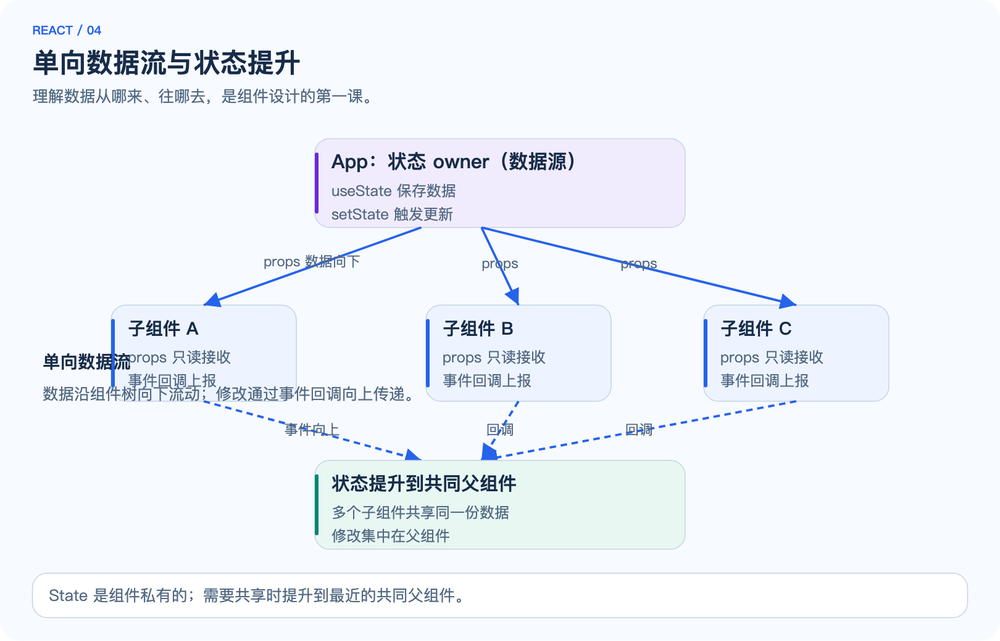

*图 4：State 保存在组件内部；数据沿组件树向下流动（Props），修改通过回调函数向上传递（事件）。多个子组件需要共享同一份数据时，把状态提升到最近的共同父组件。*

当两个子组件需要同一份数据时，把 State 提升到它们的共同父组件，通过 Props 下发，通过回调更新：

```jsx
function Parent() {
  const [items, setItems] = useState(['甲', '乙']);

  function addItem(text) {
    setItems([...items, text]); // 用新数组替换，而不是修改原数组
  }

  return (
    <div>
      <Input onAdd={addItem} />
      <List items={items} />
    </div>
  );
}
```

“状态提升”是 React 里最频繁出现的重构手法：先让数据待在最贴近使用处，等发现多个组件需要共享时再上移。不要一开始就把所有状态放进全局。

### 4.4 状态更新是异步的：批量处理

同一事件内的多次 `setCount` 不会立即生效，React 会批量合并：

```jsx
setCount(count + 1);
setCount(count + 1);
// 结果不是 +2，而是 +1：两次都基于同一个旧 count
```

需要基于“上一次的值”更新时，用函数式更新：

```jsx
setCount((prev) => prev + 1);
setCount((prev) => prev + 1); // 这次是 +2
```

另外，`setCount(count + 1)` 之后立刻读取 `count`，拿到的仍是旧值——State 要到下一次渲染才更新。理解这一点能避免大量“为什么数据没变”的困惑。[State 更新队列](https://react.dev/learn/queueing-a-series-of-state-updates)

## 5. 核心概念三：列表与条件渲染

### 5.1 列表渲染与 key

把数组映射成列表是 React 最常用的操作，`map` 返回一组 JSX：

```jsx
function TodoList({ todos }) {
  return (
    <ul>
      {todos.map((todo) => (
        <li key={todo.id}>{todo.text}</li>
      ))}
    </ul>
  );
}
```

`key` 是给 React 的提示：列表中哪个元素对应哪份数据。规则：

| 做法 | 是否推荐 | 原因 |
| --- | --- | --- |
| 用数据自带的稳定 id | ✅ 推荐 | 数据变化时 React 能准确对应 |
| 用数组下标 index | ⚠️ 仅在列表静态时可用 | 插入 / 删除会让后续项的对应关系错位 |
| 用随机数 | ❌ 不要 | 每次渲染都变，破坏对应关系甚至引发状态错乱 |

`key` 不是传给组件的 Props：组件内部读不到 `key`。它的唯一作用是帮助 React 在更新时识别元素。[渲染列表](https://react.dev/learn/rendering-lists)

### 5.2 条件渲染

JSX 里用 JavaScript 表达式做条件：

```jsx
function Status({ loading, error, data }) {
  if (loading) return <p>加载中…</p>;
  if (error) return <p className="error">出错了：{error}</p>;
  return <p>数据：{data}</p>;
}
```

常见的几种写法：

```jsx
{isLoggedIn ? <LogoutButton /> : <LoginButton />}   // 三目
{isLoggedIn && <LogoutButton />}                     // 短路：满足才渲染
{items.length > 0 || <EmptyHint />}                  // 或：不满足时渲染
```

注意 `&&` 的坑：`{items.length && <List />}` 在 `items.length` 为 0 时会渲染出 `0`。要用 `{items.length > 0 && <List />}`。[条件渲染](https://react.dev/learn/conditional-rendering)

### 5.3 组合练习：一个带过滤的列表

把第 4、5 章的知识合起来：状态、事件、受控组件、条件渲染、列表渲染。

```jsx
import { useState } from 'react';

const initialItems = [
  { id: 1, name: '学习 JSX', done: true },
  { id: 2, name: '学习 State', done: false },
  { id: 3, name: '学习列表渲染', done: false },
];

export default function FilterList() {
  const [items, setItems] = useState(initialItems);
  const [filter, setFilter] = useState('all');

  const visible = items.filter((item) =>
    filter === 'all' ? true : filter === 'done' ? item.done : !item.done
  );

  function toggle(id) {
    setItems(items.map((item) => (item.id === id ? { ...item, done: !item.done } : item)));
  }

  return (
    <div>
      <select value={filter} onChange={(e) => setFilter(e.target.value)}>
        <option value="all">全部</option>
        <option value="done">已完成</option>
        <option value="todo">未完成</option>
      </select>
      <ul>
        {visible.map((item) => (
          <li key={item.id}>
            <label>
              <input type="checkbox" checked={item.done} onChange={() => toggle(item.id)} />
              {item.name}
            </label>
          </li>
        ))}
      </ul>
    </div>
  );
}
```

这段代码演示了三个重要模式：**派生状态用计算而不是复制**（`visible` 由 `items` 与 `filter` 实时算出）、**更新用不可变方式**（`map` 返回新数组）、**checked 受控**（勾选状态来自数据）。
## 6. 核心概念四：Hooks 深入

### 6.1 useEffect：副作用的管理

渲染本身应该是“纯”的：同样的输入得到同样的界面。但真实应用需要请求数据、订阅事件、操作定时器——这些“渲染之外的动作”叫副作用，用 `useEffect` 声明：

```jsx
import { useEffect, useState } from 'react';

function Clock() {
  const [now, setNow] = useState(new Date());

  useEffect(() => {
    const timer = setInterval(() => setNow(new Date()), 1000);
    return () => clearInterval(timer); // 清理函数：卸载时执行
  }, []); // 空依赖：只挂载时执行一次

  return <p>现在时间：{now.toLocaleTimeString()}</p>;
}
```

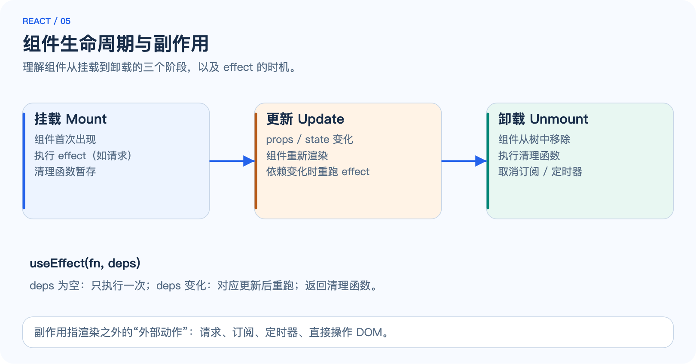

*图 5：组件经历挂载、更新、卸载三个阶段。effect 在挂载后执行；依赖变化时在更新后重跑；返回的清理函数在下次 effect 前与卸载时执行。*

`useEffect(fn, deps)` 的执行时机：

| 依赖数组 | 执行时机 | 典型用途 |
| --- | --- | --- |
| 不传 | 每次渲染后 | 少见；通常意味着设计有问题 |
| `[]` | 仅挂载后执行一次 | 请求初始数据、订阅 |
| `[a, b]` | `a` 或 `b` 变化后执行 | 依赖外部数据重新请求 |
| 返回清理函数 | 下次 effect 前 + 卸载时 | 取消订阅、清定时器、断开连接 |

**不要在 effect 里手动同步 State。** `useEffect(() => setX(compute(x)), [x])` 会造成“渲染 → effect → 再渲染”的额外循环；能直接计算的值应该在渲染期间计算。[Effect 的时机](https://react.dev/learn/lifecycle-of-reactive-effects)

### 6.2 useRef：不触发渲染的“抽屉”

`useRef` 返回一个稳定的容器对象，`.current` 可以保存任意值。与 State 的区别是：**修改 ref 不会触发重新渲染**。

```jsx
import { useRef } from 'react';

function AutofocusInput() {
  const inputRef = useRef(null);
  return (
    <input
      ref={inputRef}
      onFocus={() => console.log('焦点元素：', inputRef.current)}
    />
  );
}
```

常用场景：访问 DOM 节点（focus、测量尺寸）、保存定时器 id、保存“上一次的值”。React 19 中，`ref` 可以作为普通 prop 传给函数组件（不再需要 `forwardRef`）。[ref 的用法](https://react.dev/learn/referencing-values-with-refs)

### 6.3 useMemo 与 useCallback：缓存计算与引用

默认情况下组件每次渲染都会重新执行全部代码。当计算昂贵、或子组件因引用变化被反复重渲染时，可以用缓存：

```jsx
import { useMemo, useCallback } from 'react';

function Dashboard({ rows }) {
  // 仅当 rows 变化时才重新计算
  const stats = useMemo(() => expensiveSummary(rows), [rows]);

  // 仅当依赖变化时才更换函数引用
  const handleClick = useCallback(() => setPage(1), []);

  return <StatsView data={stats} onClick={handleClick} />;
}
```

重要提醒：`useMemo` / `useCallback` 是**优化手段，不是语义保证**。React 可能随时丢弃缓存重新计算，因此不能依赖它们保证“只执行一次”。**先测量，再优化**；过早把每个值都包上缓存反而增加复杂度。[useMemo](https://react.dev/reference/react/useMemo) · [useCallback](https://react.dev/reference/react/useCallback)

### 6.4 自定义 Hook：封装可复用逻辑

以 `use` 开头的函数就是自定义 Hook，可以把“状态 + 副作用”的逻辑打包复用：

```jsx
import { useEffect, useState } from 'react';

function useDocumentTitle(title) {
  useEffect(() => {
    document.title = title;
  }, [title]);
}

function useWindowSize() {
  const [size, setSize] = useState({ width: window.innerWidth, height: window.innerHeight });
  useEffect(() => {
    const onResize = () => setSize({ width: window.innerWidth, height: window.innerHeight });
    window.addEventListener('resize', onResize);
    return () => window.removeEventListener('resize', onResize);
  }, []);
  return size;
}
```

```jsx
function Page() {
  useDocumentTitle('我的页面');
  const { width } = useWindowSize();
  return <p>窗口宽度：{width}</p>;
}
```

自定义 Hook 是 React 生态里最常见的抽象方式：请求数据的 `useFetch`、表单的 `useForm`、主题的 `useTheme` 都是这种模式。**Hook 之间可以互相调用**，但只能在组件或自定义 Hook 的顶层调用。

### 6.5 Hooks 规则

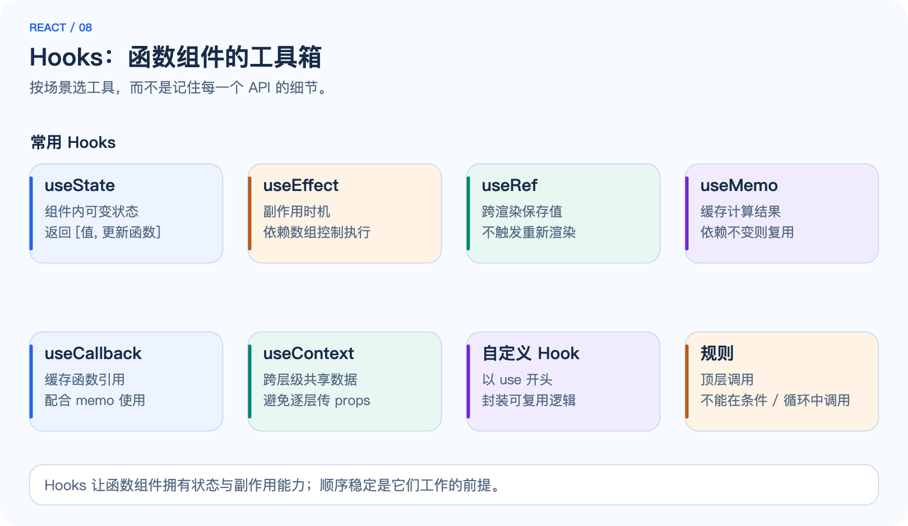

*图 8：常用 Hooks 按场景分类：状态（useState）、副作用（useEffect）、引用（useRef）、缓存（useMemo / useCallback）、共享（useContext），以及以 use 开头的自定义 Hook。*

Hooks 有两条铁律：

1. **只在顶层调用。** 不要在条件、循环或嵌套函数里调用 Hook。React 依赖调用顺序来记住每个 Hook 属于哪个状态。
2. **只在 React 函数中调用。** 组件函数或自定义 Hook 里调用；普通函数里不能调用。

```jsx
// ❌ 错误：条件里调用 Hook，渲染顺序会不稳定
if (visible) {
  const [x, setX] = useState(0);
}

// ✅ 正确：条件放到 Hook 内部或之后
const [x, setX] = useState(0);
if (visible) { /* 逻辑照常 */ }
```

React 提供 eslint-plugin-react-hooks 自动检查这些规则。[Hook 规则](https://react.dev/reference/rules/rules-of-hooks)

## 7. 实现原理：从虚拟 DOM 到并发渲染

### 7.1 React 元素与虚拟 DOM

React 元素（element）是描述界面的普通对象，不是真实 DOM 节点。每次渲染，组件函数返回新的元素树，React 在内存中维护这棵树——这就是“虚拟 DOM”。

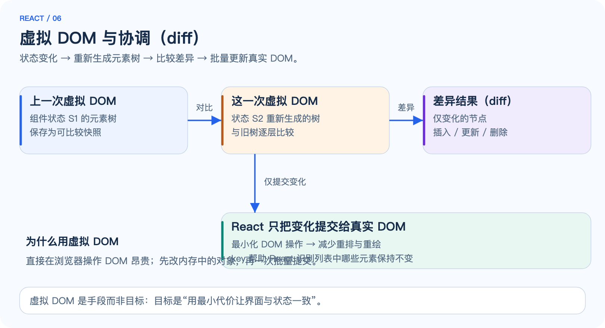

*图 6：状态变化后生成新的元素树，React 将新旧两棵树逐层比较，找出差异，再以最小代价更新真实 DOM。*

为什么需要中间层：直接操作真实 DOM 昂贵（触发重排、重绘、事件绑定重建）。先在内存对象上计算“哪些地方变了”，再一次批量提交，能显著减少昂贵的浏览器操作。**虚拟 DOM 是手段，不是目标**——目标是让界面与状态以可控成本保持一致。

### 7.2 协调（Reconciliation）：找出差异

协调是 React 比较新旧元素树、得出更新计划的过程。它基于两个经验假设：

1. **不同类型的元素产生不同子树。** `<div>` 变成 `<p>`，React 直接重建整棵子树，不再深比较。
2. **同类型元素尽量复用。** 通过 `key` 识别列表中哪些元素保持同一身份。

```jsx
// 位置 1：类型相同，只更新文本
{isOpen ? <p>展开</p> : <p>收起</p>}   // React 复用 <p>，只改文本

// 位置 2：类型不同，整棵重建
{isOpen ? <p>展开</p> : <span>收起</span>}  // <p> 销毁，<span> 新建
```

理解“类型变化会重建子树”很重要：如果一个组件的位置在条件切换时被不同类型包裹，它的 State 会丢失——因为整个子树被重建了。

### 7.3 渲染流程：render 与 commit

一次状态更新分为两个阶段：

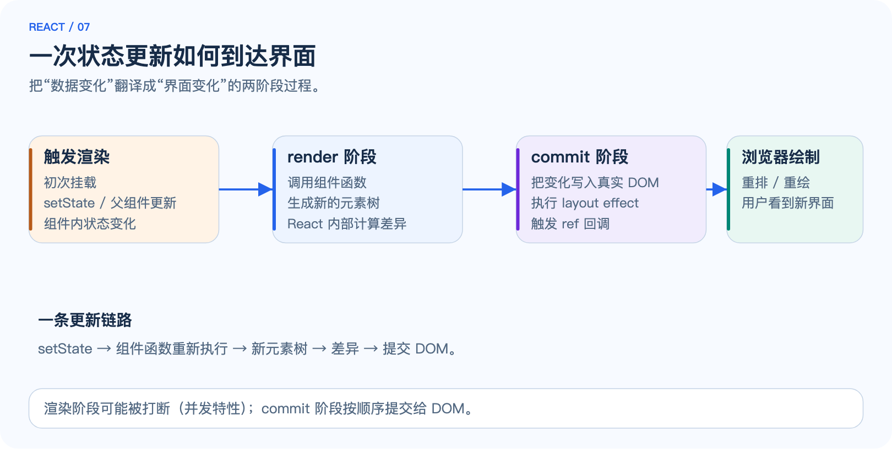

*图 7：setState 触发渲染阶段（重新执行组件、生成新元素树、计算差异），随后是提交阶段（把变化写入真实 DOM、执行 effect 与 ref 回调），最后浏览器绘制。*

| 阶段 | 做什么 | 特点 |
| --- | --- | --- |
| render（渲染阶段） | 调用组件函数，生成元素树，计算差异 | 可能被中断（并发特性）；不触碰真实 DOM |
| commit（提交阶段） | 把差异应用到真实 DOM，执行 layout effect | 顺序执行，不可中断 |
| 浏览器绘制 | 重排、重绘、显示结果 | React 无法控制 |

React 19 及 18+ 支持并发特性（`useTransition`、`useDeferredValue` 等），让渲染阶段可以被打断、可以标记低优先级更新，从而避免大更新阻塞输入响应。这解释了为什么“渲染阶段的代码要纯”：它可能被暂停、重放或丢弃。[渲染与提交](https://react.dev/learn/render-and-commit)

### 7.4 Fiber：可中断的渲染工作单元

“虚拟 DOM 比较”回答了**改哪里**，但没有回答**怎么一步步算出来**。React 15 时代的协调器是递归的：一旦开始渲染整棵组件树，浏览器就无法响应输入，大型界面会明显卡顿。React 16+ 引入 **Fiber 架构**解决了这个问题。

Fiber 是渲染的最小工作单元：每个组件、每个 DOM 元素都对应一个 fiber 节点。与元素树不同，fiber 节点之间用指针连接成链表：

- `child`：第一个子节点。
- `sibling`：下一个兄弟节点。
- `return`：父节点，渲染完成后沿它向上回溯。

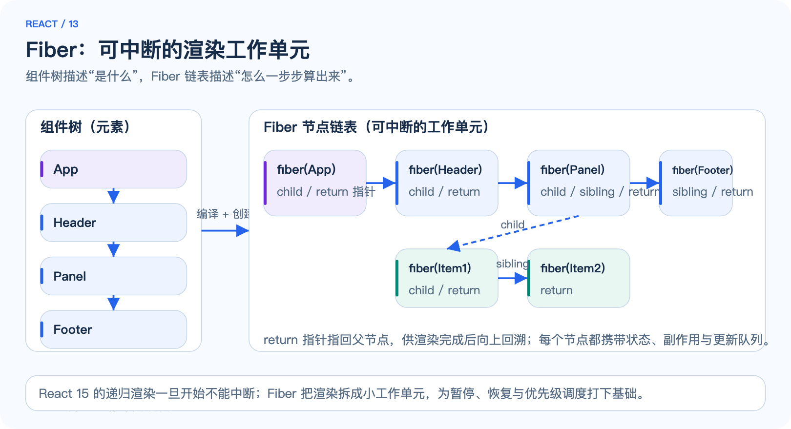

*图 13：组件树描述“界面是什么”，Fiber 链表描述“怎么一步步算出来”。每个 fiber 携带该节点的状态、副作用与更新队列。*

Fiber 的价值在于把一次完整的渲染拆成**许多可以独立推进的小步骤**：渲染器算几个节点就停下来，把控制权交还浏览器处理输入，再继续。这让渲染“可中断、可恢复、可丢弃”，是并发调度的地基。[Fiber 架构（React 内部资料）](https://github.com/acdlite/react-fiber-architecture)

### 7.5 双缓存：渲染不被打断才能提交

如果渲染中途被打断，用户会看到“半成品”界面吗？不会。React 同时维护两棵 Fiber 树：

| 树 | 作用 | 特点 |
| --- | --- | --- |
| current 树 | 用户当前看到的界面 | 稳定，不修改 |
| workInProgress 树 | 本次更新正在构建的结果 | 从 current 复制而来，逐步修改 |

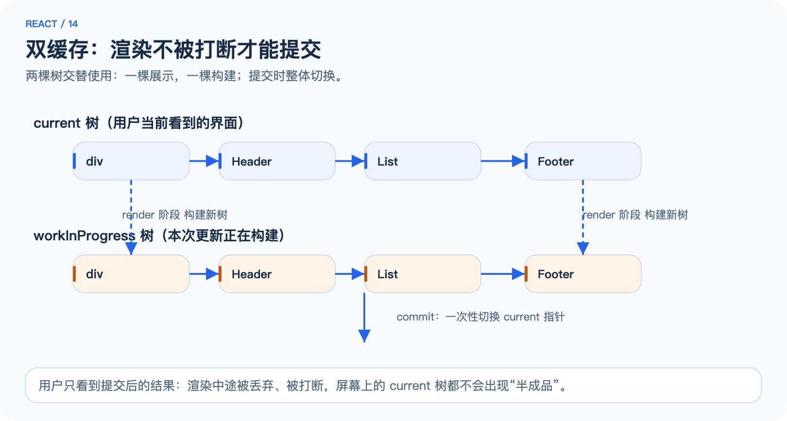

*图 14：render 阶段构建 workInProgress 树，commit 阶段一次性把 current 指针切到新树。被丢弃的中间结果对用户不可见。*

这个机制叫 **双缓存（double buffering）**，与图形学里的概念同源：一边展示、一边绘制，绘制完成后整体切换。它带来两个重要性质：

1. **渲染可丢弃**：高优先级更新插入时，正在构建的 workInProgress 树直接作废重来，用户看到的 current 树不受影响。
2. **commit 是原子切换**：所有 DOM 变化在 commit 阶段一次性应用，不会出现“改了一半”的中间态。

这也再次说明为什么**渲染阶段的代码必须是纯的**：它可能在提交前被多次执行或丢弃，任何对外部世界的修改都会造成不可预测的重复。

### 7.6 Hooks 的实现：为什么调用顺序是铁律

函数组件没有“实例”，那么 `useState` 的状态存在哪里？答案：**存在 fiber 节点的 `memoizedState` 链表上。**

组件每执行一次，React 就按调用顺序把 Hooks 依次挂到链表尾部：

```jsx
function Counter() {
  const [count, setCount] = useState(0);  // hook 节点 1：保存 count
  useEffect(() => {...}, [count]);        // hook 节点 2：保存 effect 与依赖
  const ref = useRef(null);               // hook 节点 3：保存 ref 对象
}
```

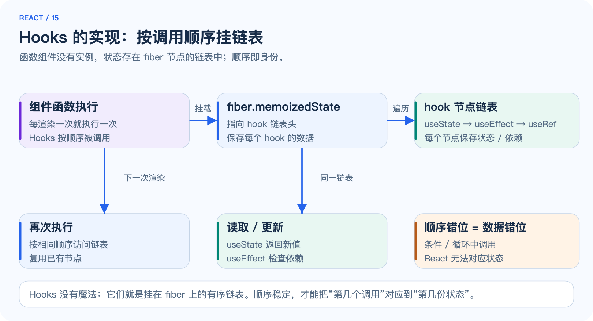

*图 15：useState、useEffect、useRef 依次成为 fiber 上的链表节点。下一次渲染按相同顺序遍历链表，读取或复用对应节点的数据。*

这就解释了第 6 章的 Hooks 规则为什么是铁律：

- **顺序即身份**：React 不知道“这个 useState 是计数值”，只知道“这是第 1 个 hook 节点”。如果某次渲染第 1 个 hook 是 `useState`、下次变成了 `useEffect`，状态就会错位。
- 所以在条件、循环或嵌套函数里调用 Hooks，等于改变链表结构，React 无法把状态对应到正确的位置。

**“Hooks 有魔法”是常见的误解。** 它们就是挂在 fiber 上的有序链表，仅此而已。[Hooks 规则背后的原理](https://react.dev/reference/rules/rules-of-hooks)

### 7.7 合成事件：委托到 root 再分发

你在 JSX 里写的 `onClick` 并不会直接绑定到每个 DOM 节点。React 17+ 把所有事件监听器**委托到根容器**（root），利用事件冒泡统一接收，再按 Fiber 树把事件分发给对应的组件：

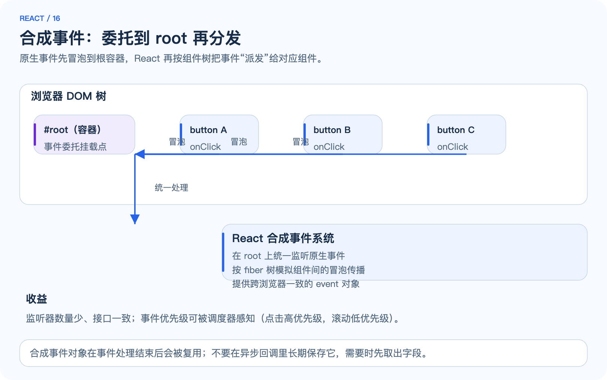

*图 16：按钮的点击事件先冒泡到 root 容器，React 统一接收后，按 Fiber 树找到事件处理器所在的组件并调用。*

这样做的收益：

1. **监听器数量少**：无论页面上有多少个按钮，root 上只挂有限的几个监听器。
2. **接口一致**：React 包装出合成事件对象（SyntheticEvent），抹平不同浏览器的事件差异；`e.stopPropagation()` 等在 React 内部按组件树语义工作。
3. **可感知优先级**：离散事件（点击、输入）优先级高，连续事件（滚动、拖动）优先级低，调度器可以据此安排渲染顺序。

一个常见坑：**合成事件对象会被复用。** 事件处理函数返回后，事件对象会被回收；在异步回调（`setTimeout`、`fetch.then`）里读取 `e.target` 会拿到空值。需要时先在同步代码里取出字段。[合成事件参考](https://react.dev/reference/react-dom/components/common)

### 7.8 并发渲染与优先级调度

React 19 及 18+ 的“并发特性”听起来神秘，本质是两件事：

1. **渲染可中断**：借助 Fiber，渲染可以暂停、让位、重做（第 7.4 节）。
2. **更新有优先级**：紧急更新（输入、点击）先算，非紧急更新（大列表、过滤结果）后算。

```jsx
import { useState, useTransition } from 'react';

function SearchPage() {
  const [query, setQuery] = useState('');
  const [results, setResults] = useState([]);
  const [isPending, startTransition] = useTransition();

  function handleChange(e) {
    setQuery(e.target.value);            // 紧急：输入框立刻响应
    startTransition(() => {              // 非紧急：结果计算可让路
      setResults(expensiveFilter(allData, e.target.value));
    });
  }

  return (
    <div>
      <input value={query} onChange={handleChange} />
      {isPending && <p>筛选计算中…</p>}
      <List items={results} />
    </div>
  );
}
```

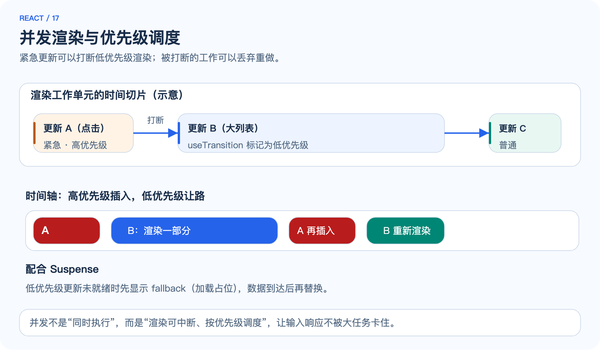

*图 17：时间轴上，高优先级更新（A）可以插入并打断低优先级渲染（B）；被打断的工作作废后重做。配合 Suspense，低优先级内容未就绪时可先显示 fallback。*

配合 `Suspense`：低优先级更新涉及的数据未就绪时，React 先渲染 fallback（加载占位），数据到达后无缝替换，而不是让整页卡住等待。

**并发不是“同时执行多任务”**，而是“渲染按优先级调度、可以被更高优先级打断”。这也是为什么“渲染阶段必须纯”：React 可能丢弃并重放你的组件函数。[并发特性入门](https://react.dev/blog/2024/04/25/react-19) · [useTransition](https://react.dev/reference/react/useTransition) · [Suspense](https://react.dev/reference/react/Suspense)

### 7.9 key 为什么重要

回到第 5 章的 key：协调阶段用 key 判断列表元素身份。没有 key 或使用下标，插入/删除会让 React 把“错的元素”当成“同一个元素”复用，导致状态错位：

```jsx
// 列表头部插入一项，React 靠 key 知道每项身份没变，只插入新节点
{items.map((item) => <Row key={item.id} item={item} />)}
```

用稳定 id 作为 key 是唯一推荐做法；下标 key 只在列表永不增删时安全。

### 7.10 渲染优化的边界

“重新渲染”不等于“性能差”。React 的重渲染是高效的内存比较，真正的成本在于：组件函数体很重、或 commit 阶段 DOM 更新很多。优化的常见顺序：

1. **先看数据流是否合理**：派生值直接计算，避免多余的中间 State。
2. **减少大列表的 DOM 成本**：虚拟化（只渲染可视区）、分批渲染。
3. **`memo` + `useCallback`**：子组件因 props 引用变化被频繁重渲染时，缓存引用并跳过重渲染。

```jsx
import { memo } from 'react';

const ExpensiveRow = memo(function ExpensiveRow({ item, onToggle }) {
  return <Row item={item} onToggle={onToggle} />;
});
```

`memo` 让组件在 props 没变化时跳过重新渲染。它只对“props 引用相同”有效，所以常与 `useCallback` 配合。**不要到处套 memo**——先测量确认瓶颈，再动手。[性能优化](https://react.dev/learn/performance)

## 8. 实践一：Todo 应用

### 8.1 实验目标

**目标：** 用一个小 Todo 应用把 JSX、组件、Props、State、列表渲染、事件串成完整闭环。约 30～45 分钟。

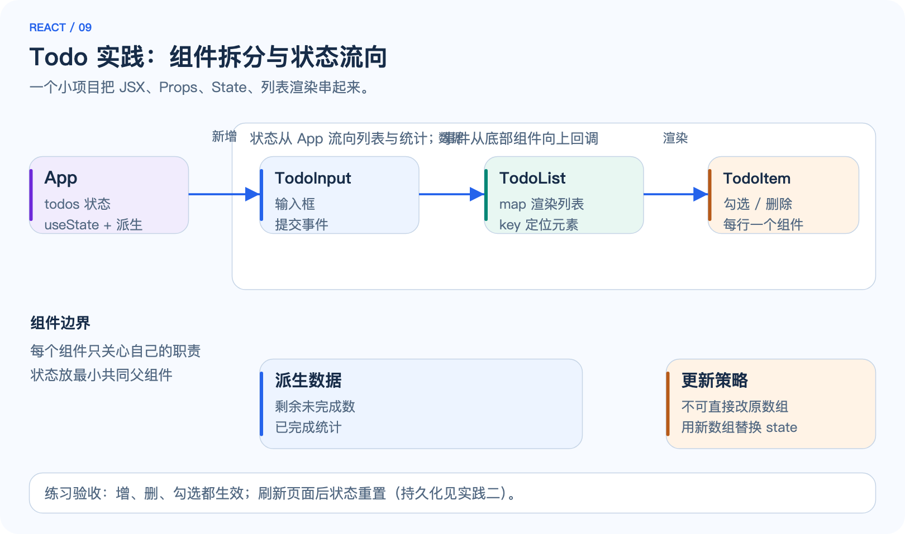

*图 9：状态（todos）保存在 App，通过 Props 下发到 TodoInput（新增）与 TodoList（渲染），勾选 / 删除通过回调向上传递。*

功能设计：

- 输入框输入文字，回车或点击按钮新增。
- 列表展示所有条目，每行可勾选完成、可删除。
- 底部显示“剩余 n 项未完成”。

### 8.2 组件拆分

```text
src/
└── App.jsx            # 持有 todos 状态，组合下面三个组件
    ├── TodoInput      # 输入框 + 新增按钮（受控组件）
    ├── TodoList       # map 渲染 TodoItem（key = todo.id）
    └── TodoItem       # 单行：勾选框 + 文本 + 删除按钮
```

每个组件只做一件事。状态放在“需要它的最小共同父组件”——这里 todos 由列表和统计共用，放在 App。

### 8.3 完整代码

`App.jsx`：

```jsx
import { useState } from 'react';
import TodoInput from './TodoInput.jsx';
import TodoList from './TodoList.jsx';

let nextId = 3;
const initialTodos = [
  { id: 1, text: '阅读第 4 章：State 与事件', done: true },
  { id: 2, text: '完成 Todo 实践', done: false },
];

export default function App() {
  const [todos, setTodos] = useState(initialTodos);

  function addTodo(text) {
    setTodos([...todos, { id: nextId++, text, done: false }]);
  }

  function toggleTodo(id) {
    setTodos(todos.map((t) => (t.id === id ? { ...t, done: !t.done } : t)));
  }

  function deleteTodo(id) {
    setTodos(todos.filter((t) => t.id !== id));
  }

  const remaining = todos.filter((t) => !t.done).length;

  return (
    <div className="app">
      <h1>我的 Todo</h1>
      <TodoInput onAdd={addTodo} />
      <TodoList todos={todos} onToggle={toggleTodo} onDelete={deleteTodo} />
      <p>剩余 {remaining} 项未完成</p>
    </div>
  );
}
```

`TodoInput.jsx`：

```jsx
import { useState } from 'react';

export default function TodoInput({ onAdd }) {
  const [text, setText] = useState('');

  function handleSubmit(e) {
    e.preventDefault();
    const trimmed = text.trim();
    if (!trimmed) return;
    onAdd(trimmed);
    setText('');
  }

  return (
    <form onSubmit={handleSubmit}>
      <input value={text} onChange={(e) => setText(e.target.value)} placeholder="要做点什么？" />
      <button type="submit">新增</button>
    </form>
  );
}
```

`TodoList.jsx` 与 `TodoItem.jsx`：

```jsx
import TodoItem from './TodoItem.jsx';

export default function TodoList({ todos, onToggle, onDelete }) {
  return (
    <ul>
      {todos.map((todo) => (
        <TodoItem key={todo.id} todo={todo} onToggle={onToggle} onDelete={onDelete} />
      ))}
    </ul>
  );
}
```

```jsx
export default function TodoItem({ todo, onToggle, onDelete }) {
  return (
    <li>
      <label>
        <input type="checkbox" checked={todo.done} onChange={() => onToggle(todo.id)} />
        <span style={{ textDecoration: todo.done ? 'line-through' : 'none' }}>{todo.text}</span>
      </label>
      <button onClick={() => onDelete(todo.id)}>删除</button>
    </li>
  );
}
```

### 8.4 要点与验收

**不可变更新**是这段代码的核心纪律：`addTodo` 用展开创建新数组，`toggleTodo` 用 `map` 返回新数组，`deleteTodo` 用 `filter` 返回新数组——**从不修改原数组**。直接 `todos.push(...)` 不会触发更新，还会留下难以排查的隐患。

验收：

1. 新增、勾选、删除全部生效，剩余计数正确。
2. 在浏览器开发者工具里观察：每次操作后 React 更新了哪些 DOM 节点。
3. 尝试把 `key={todo.id}` 改成 `key={index}`，在列表头部插入一项，观察勾选状态是否错位——用实际现象理解 key 的作用。

**刷新页面后状态会重置**，因为 todos 只存在于内存。把数据持久化是实践二的内容。

## 9. 实践二：与后端交互

### 9.1 请求三态

真实应用的数据来自后端 API。一个请求的生命周期可以归纳为三种状态：加载中、成功、失败。**把这三态建模进 State，是请求代码的通用骨架：**

```jsx
import { useEffect, useState } from 'react';

function useTodos() {
  const [todos, setTodos] = useState(null); // null = 加载中
  const [error, setError] = useState(null);

  useEffect(() => {
    let cancelled = false;
    fetch('/api/todos')
      .then((res) => {
        if (!res.ok) throw new Error(`HTTP ${res.status}`);
        return res.json();
      })
      .then((data) => { if (!cancelled) setTodos(data); })
      .catch((err) => { if (!cancelled) setError(err.message); });
    return () => { cancelled = true; }; // 组件卸载 / 依赖变化时忽略过期结果
  }, []);

  return { todos, error };
}
```

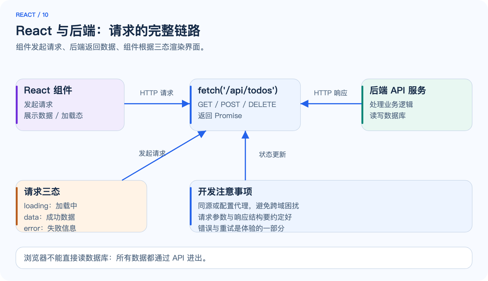

*图 10：组件发起 fetch 请求，后端处理业务并读写数据库，返回 JSON；组件根据请求三态（加载中 / 成功 / 失败）渲染不同界面。*

组件里按三态渲染：

```jsx
function TodoPage() {
  const { todos, error } = useTodos();

  if (error) return <p className="error">加载失败：{error}</p>;
  if (!todos) return <p>加载中…</p>;
  return <TodoList todos={todos} />;
}
```

### 9.2 把 Todo 接上后端

把第 8 章的 Todo 从“内存数据”改为“API 数据”：

```jsx
// 新增
async function addTodo(text) {
  const res = await fetch('/api/todos', {
    method: 'POST',
    headers: { 'Content-Type': 'application/json' },
    body: JSON.stringify({ text }),
  });
  if (!res.ok) throw new Error(`HTTP ${res.status}`);
  const created = await res.json();
  setTodos((prev) => [...prev, created]);
}

// 勾选
async function toggleTodo(id) {
  const todo = todos.find((t) => t.id === id);
  await fetch(`/api/todos/${id}`, {
    method: 'PATCH',
    headers: { 'Content-Type': 'application/json' },
    body: JSON.stringify({ done: !todo.done }),
  });
  setTodos(todos.map((t) => (t.id === id ? { ...t, done: !t.done } : t)));
}
```

两个细节值得注意：

1. **乐观更新 vs 等待响应。** 上例先发请求、成功后再更新 State（更稳但更慢）。也可以先更新界面、失败再回滚（体验更好但更复杂）。小项目从“等待响应”开始。
2. **错误要能看见。** 请求失败应显示提示而不是静默失败；操作按钮在请求期间应禁用，避免重复提交。

### 9.3 开发环境跨域：配置 Vite 代理

浏览器有同源策略：页面在 `http://localhost:5173`，API 在 `http://localhost:8000` 时，直接 fetch 会跨域。开发阶段最常见的解法是让 Vite 代理 `/api` 到后端：

```js
// vite.config.js
import { defineConfig } from 'vite';
import react from '@vitejs/plugin-react';

export default defineConfig({
  plugins: [react()],
  server: {
    proxy: {
      '/api': 'http://localhost:8000', // 开发服务器把 /api 转发给后端
    },
  },
});
```

配置后，前端代码里统一写 `fetch('/api/todos')`（相对路径），浏览器同源，开发时由 Vite 转发，部署时由 Nginx 等反向代理转发。**不要在浏览器代码里硬编码后端地址**——这会让环境切换变得脆弱。[Vite 代理](https://vitejs.dev/config/server-options#server-proxy)

### 9.4 与容器化后端联调

如果后端运行在 Docker Compose 里（例如本仓库 docker 知识点的全栈案例），联调要点：

| 问题 | 原因 | 处理 |
| --- | --- | --- |
| 前端容器请求 `localhost:8000` 失败 | 容器里 localhost 指向容器自己 | 前端用宿主机可访问地址，或经 Nginx 同源代理 |
| API 与前端不在同一网络 | 各自独立容器网络 | 用 Compose 统一编排，让 Nginx 代理 `/api` |
| 跨域报错 | 浏览器同源策略 | 开发用 Vite 代理，部署用同源 Nginx |

原则与 docker 文档第 5 章一致：**让浏览器只访问同源地址，内部转发交给服务器。**

## 10. 实践三：路由与构建部署

### 10.1 为什么需要路由

单页应用（SPA）只有一个 HTML 文件，但用户需要多个“页面”：首页、列表页、详情页。路由解决的是：**URL 与界面组件之间的映射**，并支持刷新、前进后退、直接访问。

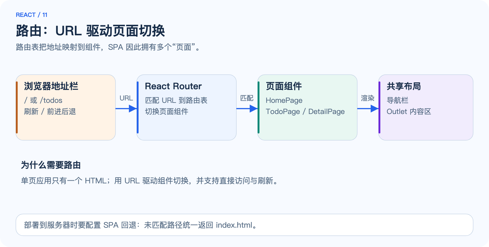

*图 11：浏览器地址 → 路由表匹配 → 渲染对应页面组件；导航栏等共享布局包裹内容区。*

### 10.2 使用 React Router

React 生态最常用的路由库是 React Router：

```bash
npm install react-router-dom
```

```jsx
import { BrowserRouter, Routes, Route, Link } from 'react-router-dom';
import HomePage from './pages/HomePage.jsx';
import TodoPage from './pages/TodoPage.jsx';

export default function App() {
  return (
    <BrowserRouter>
      <nav>
        <Link to="/">首页</Link>
        <Link to="/todos">Todo</Link>
      </nav>
      <Routes>
        <Route path="/" element={<HomePage />} />
        <Route path="/todos" element={<TodoPage />} />
      </Routes>
    </BrowserRouter>
  );
}
```

要点：

- `<Link to="/todos">` 代替 `<a href>`：拦截点击、不刷新页面、只更新 URL 与组件。
- `<Routes>` 与 `<Route path element>` 声明路由表：按当前 URL 匹配渲染。
- 动态路径 `/todos/:id`，组件里用 `useParams()` 读取 `id`；`useNavigate()` 编程式跳转。
- 未匹配路径可以加 `<Route path="*" element={<NotFound />} />`。

### 10.3 构建：把源码变成静态文件

```bash
npm run build
```

Vite 会把 JSX、组件与样式打包压缩，输出到 `dist/` 目录：

```text
dist/
├── index.html          # 唯一入口
└── assets/
    ├── index-xxxx.js   # 打包后的 JavaScript（哈希命名，便于缓存）
    └── index-xxxx.css
```

`dist/` 是**纯静态文件**，可以复制、上传到任意静态托管：Nginx、GitHub Pages、对象存储 + CDN 等。构建产物不依赖 Node 环境——浏览器直接加载它们。

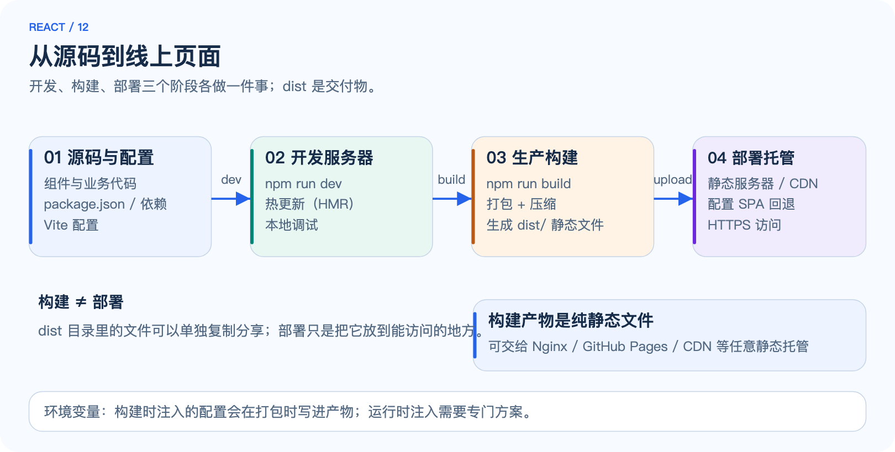

*图 12：开发（npm run dev，热更新）→ 构建（npm run build，产出 dist/）→ 部署（静态托管）。dist 是交付物，可以单独复制分享。*

### 10.4 部署与 SPA 回退

静态托管服务器需要处理一个 SPA 特有的问题：用户直接访问 `/todos` 时，服务器上并不存在 `todos` 文件。需要把未匹配路径回退到 `index.html`：

```nginx
# Nginx 配置片段：SPA 回退
location / {
    try_files $uri $uri/ /index.html;
}
```

```text
# 其他平台也都有等价配置：Netlify 用 _redirects，Vercel 用 vercel.json 等
```

不配置回退时，直接访问子路由会得到 404。**这个配置是部署 React SPA 最常见的一步遗漏。**

### 10.5 构建变量与运行时配置

构建时注入的环境变量会在打包时写进产物：

```bash
VITE_API_BASE=https://api.example.com npm run build
```

```jsx
// 代码里通过 import.meta.env 读取
const base = import.meta.env.VITE_API_BASE ?? '/api';
```

注意：以 `VITE_` 开头的变量才会被 Vite 打进前端产物；产物里的变量值在构建时固定，之后改环境变量不会改变已构建的文件。**浏览器可见的配置里不能放服务端密钥**——任何打包进前端的值用户都能看到。
## 11. 工程化与最佳实践

### 11.1 组件设计原则

| 原则 | 含义 | 反例 |
| --- | --- | --- |
| 单一职责 | 一个组件只做一件事 | 一个组件既渲染表单又管全局路由 |
| Props 保持简单 | 传基础数据，少传深层对象 | 把整个 store 塞进 props |
| 状态靠近使用处 | 谁用谁持有，必要时才提升 | 所有状态都放顶层组件 |
| 派生值不复制 | 能算出来的不存 State | `filteredList` 单独存一份 State |
| 组件可组合 | 用 children / props 扩展 | 为每个变体复制一份组件 |

### 11.2 目录组织

小项目按“功能”组织即可，不必过度分层：

```text
src/
├── components/        # 通用可复用组件（Button、Modal）
├── pages/             # 路由页面组件（HomePage、TodoPage）
├── hooks/             # 自定义 Hook（useFetch、useLocalStorage）
├── api/               # 请求封装（fetchTodos、createTodo）
├── App.jsx            # 根组件 / 路由
└── main.jsx           # 入口
```

随着项目变大再引入状态管理库（Zustand、Redux 等）。**一开始不需要全局状态库**——多数状态提升到父组件就够了，过早引入会掩盖设计问题。

### 11.3 测试：从组件到逻辑

测试金字塔同样适用于前端：多数是组件 / Hook 测试，少量端到端。

```jsx
// 用 Vitest + React Testing Library 做组件测试
import { render, screen } from '@testing-library/react';
import userEvent from '@testing-library/user-event';
import Counter from './Counter.jsx';

test('点击按钮计数增加', async () => {
  render(<Counter />);
  await userEvent.click(screen.getByRole('button', { name: '+1' }));
  expect(screen.getByRole('status')).toHaveTextContent('1');
});
```

测试要点：

- **测用户可观察的行为**（文本、按钮、行为），而不是实现细节（内部变量名、调用次数）。
- 交互用 `userEvent`（模拟真实输入），不用 `fireEvent` 直接派发。
- 网络请求用 mock 拦截，测试三态渲染：加载中、成功、失败。
- 测试是信心的来源，但不必追求 100% 覆盖率；优先测核心逻辑与易错分支。

### 11.4 性能优化清单

按优先级排：

1. **数据流正确**：避免多余的中间 State、避免在渲染期间做重计算。
2. **列表虚拟化**：几千行的列表用 `react-window` 等只渲染可视区。
3. **memo + useCallback**：确认子组件因引用变化被无谓重渲染时再用。
4. **代码分割**：`React.lazy` + `Suspense` 按路由懒加载，减少首屏体积。
5. **图片与字体**：懒加载图片、用现代格式、按需加载字体。

**用数据说话：** 在 React DevTools 的 Profiler 里观察哪个组件渲染耗时，再动手优化。没有测量就优化，往往优化错地方。

## 12. 排错：用证据缩小问题范围

### 12.1 一条排查顺序

先看控制台错误，再确认数据，最后检查渲染逻辑。不要一上来就删 node_modules、重装依赖或改全局配置。

```bash
# 1. 确认开发服务器日志
npm run dev

# 2. 打开浏览器开发者工具：Console 标签看报错
# 3. React DevTools：Components 面板看 props / state 是否符合预期
# 4. Network 面板：确认请求发出、状态码、响应体
# 5. 逐步隔离：注释掉可疑部分，二分定位
```

### 12.2 症状、原因与验证动作

| 症状 | 常见原因 | 先做什么 |
| --- | --- | --- |
| 页面空白，控制台报 `Cannot read properties of undefined` | 渲染时访问了不存在的对象字段 | 打印数据，确认异步数据到达前是否渲染了空值 |
| 修改 State 后界面没变 | 直接修改了数组 / 对象，没有用新引用 | 检查是否用了 `push` / `arr[i]=x`，改为不可变更新 |
| 点击后数字没加 | 多次 `setCount(count+1)` 被批量合并 | 需要基于上一次值时用函数式更新 |
| 条件渲染显示 `0` | `{items.length && ...}` 的短路陷阱 | 改为 `{items.length > 0 && ...}` |
| 列表勾选状态错乱 | key 用了下标或随机值 | 改用稳定 id 作为 key |
| 组件内部的值一直不变 | 读取的是旧渲染闭包里的值 | 理解闭包：事件回调捕获的是当次渲染的值 |
| useEffect 无限循环 | effect 里 setState，依赖又在变 | 检查依赖数组；能算的值不要在 effect 里同步 |
| 请求报 404 | 路径拼错、后端未启动、代理未配置 | 看 Network 面板实际请求的 URL |
| 跨域报 CORS 错误 | 前后端不同源 | 开发用 Vite 代理，部署用同源 Nginx |
| 直接访问子路由 404 | 服务器没配 SPA 回退 | 配置 try_files / 等效规则回退到 index.html |
| 改了代码页面没更新 | 热更新失效、缓存、编译报错 | 看终端错误，重启 dev server，强制刷新 |
| 生产页面白屏 | 构建产物路径错误、部署不完整 | 本地 `npm run build` 后用静态服务器验证 dist |
| `key` 相关控制台警告 | 列表缺 key 或 key 不唯一 | 给列表元素添加稳定的唯一 key |

### 12.3 三个最值得先掌握的调试技巧

1. **React DevTools（浏览器扩展）。** Components 面板查看组件树与 props / state 实况；Profiler 面板记录渲染耗时。
2. **Console 里打印渲染现场。** 在组件函数体里 `console.log(count)`，每次渲染都会打印，立刻看到“渲染了几次、值是多少”。
3. **最小复现。** 把问题代码抽成一个独立组件放 CodeSandbox 复现；能复现就能定位，能定位就能修复。

## 13. 一周学习计划与动手挑战

### 13.1 七天安排

| 日期 | 主题 | 当天动作 | 应产出的证据 |
| --- | --- | --- | --- |
| 第 1 天 | 概念与环境 | 阅读第 1～2 章，创建 Vite 项目，改一个组件 | 用自己的话写清声明式、组件、JSX 的区别 |
| 第 2 天 | JSX 与组件 | 阅读第 3 章，写 5 个小组件并组合 | 组件树图 + 至少一处 children 用法 |
| 第 3 天 | State 与事件 | 阅读第 4 章，完成受控表单与计数器 | 能解释批量更新与状态提升 |
| 第 4 天 | 列表与 Hooks | 阅读第 5～6 章，完成带过滤的列表 | 能解释 key、useEffect 时机与 Hooks 规则 |
| 第 5 天 | 渲染原理 | 阅读第 7 章，用 DevTools 观察渲染，画 Fiber 链表 | 能画出 render → commit 流程，能解释 Fiber 与双缓存 |
| 第 6 天 | 实践一 + 二 | 完成 Todo 应用并接上后端请求 | 增删勾选生效，三态渲染正确 |
| 第 7 天 | 路由与部署 | 完成路由 + 构建部署 | 线上页面可访问，子路由刷新不 404 |

### 13.2 四个进阶挑战

1. **状态管理：** 给 Todo 增加“编辑”功能，再尝试用 `useReducer` 重构增删改查，比较 `useState` 与 `useReducer` 的取舍。
2. **数据获取：** 实现一个 `useFetch` 自定义 Hook（含取消过期请求、错误重试），再用 `useTransition` 做搜索输入的防卡顿。
3. **组合与复用：** 用 `children` 实现一个 Modal 组件和一个布局组件，体会组合模式的扩展性。
4. **工程化：** 给 Todo 项目补充组件测试与 `React.lazy` 按路由分包，把 dist 部署到静态托管并配置 SPA 回退。

建议每个挑战都保留“假设 → 操作 → 输出 → 结论”四项记录，避免只留下能复制的代码。

## 14. 复盘题：能否脱离代码解释 React

先自己作答，再看参考要点。

| 问题 | 参考要点 |
| --- | --- |
| 1. React 是框架还是库？ | 是用于构建用户界面的库；完整框架能力（路由、SSR 等）由 Next.js 等提供 |
| 2. JSX 是 HTML 吗？ | 不是；它是 JavaScript 的语法扩展，编译为 React.createElement 调用 |
| 3. 组件为什么必须大写开头？ | React 用大小写区分组件与原生标签 |
| 4. 修改 props 会怎样？ | props 只读；需要变化的数据应放 State |
| 5. 直接改数组能触发更新吗？ | 不能；要用新数组替换 State（不可变更新） |
| 6. 为什么多次 setCount 结果可能不是累加？ | 状态更新按快照批量合并；基于上一次值要用函数式更新 |
| 7. 两个组件要共享数据怎么办？ | 状态提升到最近的共同父组件，props 下发、回调上报 |
| 8. useEffect 的依赖数组是干什么的？ | 控制 effect 何时重跑；空数组只在挂载后执行一次 |
| 9. ref 和 state 的区别是什么？ | 改 ref 不触发渲染；改 state 会触发渲染 |
| 10. key 的作用是什么？ | 帮助协调阶段识别列表元素身份，防止状态错位 |
| 11. 虚拟 DOM 的收益是什么？ | 减少直接操作真实 DOM 的高昂成本，批量提交变化 |
| 12. 渲染阶段与提交阶段有什么区别？ | 渲染阶段可中断、不碰 DOM；提交阶段把变化写入 DOM，不可中断 |
| 13. 为什么 Hooks 不能写在条件里？ | React 依赖调用顺序记住状态，条件会破坏顺序 |
| 14. 受控组件是什么？ | 表单值由 State 控制、变化写回 State 的组件 |
| 15. 部署 SPA 为什么常常要配回退？ | 服务器没有对应子路由的文件，需把未匹配路径回退到 index.html |
| 16. 前端能直接读数据库吗？ | 不能；所有数据通过 API 进出，密钥不能放前端 |

如果你能不看答案解释其中至少 12 个问题，并独立完成 Todo 应用的增删勾选、请求后端与部署，就已具备继续学习 React 生态（Next.js、状态管理、测试）的基础。这个阈值是自学检验建议，不是专业认证标准。

## 15. 官方资料与验证说明

### 15.1 按主题继续阅读

以下均为官方文档或官方项目维护的资料。本文结合多个来源进行解释与原创案例设计，不依赖转载教程。

| 主题 | 入口 |
| --- | --- |
| React 官方教程 | [react.dev/learn](https://react.dev/learn) |
| React API 参考 | [react.dev/reference/react](https://react.dev/reference/react) |
| 安装与开始 | [react.dev/learn/installation](https://react.dev/learn/installation) · [Start a new project](https://react.dev/learn/start-a-new-react-project) |
| JSX | [Writing markup with JSX](https://react.dev/learn/writing-markup-with-jsx) |
| 渲染与提交 | [Render and commit](https://react.dev/learn/render-and-commit) |
| 状态管理 | [Managing state](https://react.dev/learn/managing-state) · [Queueing state updates](https://react.dev/learn/queueing-a-series-of-state-updates) |
| Effect | [Lifecycle of reactive effects](https://react.dev/learn/lifecycle-of-reactive-effects) |
| ref | [Referencing values with refs](https://react.dev/learn/referencing-values-with-refs) |
| 列表与条件 | [Rendering lists](https://react.dev/learn/rendering-lists) · [Conditional rendering](https://react.dev/learn/conditional-rendering) |
| 性能 | [Performance](https://react.dev/learn/performance) · [useMemo](https://react.dev/reference/react/useMemo) · [useCallback](https://react.dev/reference/react/useCallback) |
| Hooks 规则 | [Rules of Hooks](https://react.dev/reference/rules/rules-of-hooks) |
| 组合模式 | [Thinking in React](https://react.dev/learn/thinking-in-react) |
| Vite | [Vite 官方文档](https://vitejs.dev/) · [Server proxy](https://vitejs.dev/config/server-options#server-proxy) |
| React Router | [React Router 官方文档](https://reactrouter.com/) |
| 测试 | [React Testing Library](https://testing-library.com/react) · [Vitest](https://vitest.dev/) |
| Next.js（进阶框架） | [Next.js 官方文档](https://nextjs.org/docs) |

### 15.2 本文的验证范围

本文的命令、目录和配置按正文保持一致；两种文档由同一 Markdown 正文生成，示意图为本次学习资料原创。以下是本次实际执行的检查范围。

| 检查项 | 本次结果 |
| --- | --- |
| 正文结构 | 16 章；HTML 与 Markdown 的代码块逐一一致 |
| 配图文件 | 17 张原创 SVG 与同名 PNG 均存在，SVG 可解析，Markdown 本地图片路径有效 |
| 代码检查 | 所有 JSX 示例按 React 19 + Vite 的语法核对；shell 命令可在对应环境执行 |
| HTML 交互 | 章节链接有效；代码复制内容一致；配图放大与关闭正常 |
| 离线与排版 | Chrome 下禁用网络仍可读取正文与全部配图；桌面及窄屏检查通过 |
| 浏览器错误 | 检查过程中未出现页面 JavaScript 异常 |

**版本说明：** 本文以 React 19 为主线，示例同样适用于 React 18（`createRoot` 挂载方式一致）。React 19 的部分新特性（如 `ref` 作为 prop、Actions）在正文相应位置说明。React 与工具链仍在演进，官方网页会更新；具体 API 与命令选项应结合你的版本核对。

**补充：与 Docker 文档的衔接。** 本仓库的 docker 知识点讲了如何把前端构建成镜像、用 Nginx 托管并配置 SPA 回退——把本章的 `dist/` 构建产物放进 Docker 多阶段构建（node 构建阶段 → nginx 运行阶段）即可组合使用，这也是“一周一个知识点”系列互相衔接的示例。


